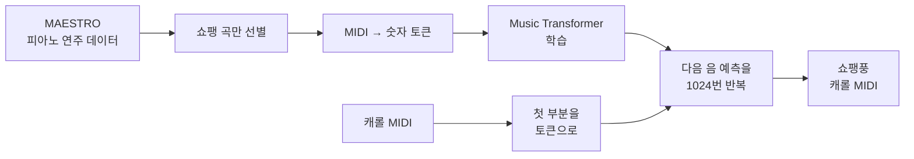

# Music Transformer로 "쇼팽이 연주하는 캐롤" 만들기
#### (대학원 수업 프로젝트)

> 쇼팽의 피아노곡으로 학습한 AI 작곡 모델에게 캐롤의 첫 소절을 들려주고,<br>
> 그 뒤를 쇼팽 스타일로 이어서 연주하게 만든 프로젝트입니다.

## 프로젝트 개요

- **목표**: Music Transformer 구조를 분석하고,<br>
  특정 작곡가 스타일로 기존 곡을 이어서 연주하는 생성 모델 구현
- **내용**: Music Transformer 모델 분석 및 "작곡가 스타일 캐롤" 생성
- **방법**: Music Transformer 논문(Huang et al., 2018)을 구현한<br>
  Keras 공식 예제를 바탕으로,
  쇼팽 곡만 골라 학습한 뒤 캐롤을 프롬프트로 입력
- **결과**: 캐롤 멜로디에 쇼팽 특유의 화성이 섞인 피아노 곡 생성<br>
  ([바로 듣기](https://mjk022.github.io/portfolio/music/))

## 프로젝트 목표

ChatGPT 같은 언어 모델은 "다음에 올 단어"를 예측하며 문장을 만듭니다.<br>
음악도 음표가 순서대로 이어진 것이니, 같은 원리로 "다음에 올 음"을 예측하면 작곡을 할 수 있습니다.<br>
이 아이디어를 구현한 것이 Google의 **Music Transformer**입니다.

이 프로젝트에서는 모델 구조를 분석하는 데서 그치지 않고<br>
**"특정 작곡가의 스타일을 배운 모델에게 익숙한 노래를 들려주면 어떻게 이어서 연주할까?"**<br>
라는 질문을 실험으로 검증하는 것을 목표로 했습니다.<br>
입력 곡으로는 멜로디가 익숙해 결과를 비교하기 쉬운 캐롤을 사용했습니다.

## 핵심 개념

**음악을 숫자로 바꾸기 (토큰화)**

MIDI 파일은 악보 대신 "어떤 건반을 눌렀다", "얼마나 세게",<br>
"몇 밀리초 뒤에", "건반을 뗐다" 같은 연주 기록을 담은 파일입니다.<br>
이 기록 하나하나를 숫자(토큰)로 바꾸면, 문장의 단어처럼 모델이 읽을 수 있습니다.

```
건반 60 누름 → 세기 70 → 20ms 대기 → 건반 60 뗌
      ↓
   [55, 77, 61, 12, 90]
```


**Music Transformer가 일반 Transformer와 다른 점**

| 구분 | 일반 Transformer (번역 등) | Music Transformer |
|---|---|---|
| 구조 | 원문을 읽는 부분 +<br>번역문을 쓰는 부분 | **쓰는 부분(Decoder)만** 사용<br>앞에 나온 음을 보고 다음 음만 이어 붙이면 되기 때문 |
| 위치 정보 | "몇 번째 단어인가"<br>(절대 위치) | **"앞 음과 얼마나 떨어져 있는가"**<br>(상대 위치) |

발표에서는 Keras 예제 코드의 Query·Key·Value 입력과 마스킹 구조를 근거로<br>
Decoder-only 구조임을 확인하고,<br>
음악 생성이 조건부 확률이 아닌 결합 확률 문제라는 점에서 그 이유를 설명했습니다.


음악에서는 같은 멜로디가 다른 위치에서 반복되는 경우가 많습니다.<br>
그래서 "3번째 음"이라는 절대 위치보다 "두 음 사이 간격"이라는 상대 위치가 더 중요하고,<br>
이것이 Music Transformer의 핵심인 **상대 위치 어텐션**입니다.<br>
이를 메모리를 적게 쓰며 계산하기 위해<br>
행렬을 비스듬히 밀어 정렬하는 **Skewing** 기법을 사용합니다.


## 수행 내용



**① 기본 예제 재현**

Keras 공식 예제를 그대로 실행해,<br>
국제 피아노 콩쿠르 연주 기록인 MAESTRO 데이터셋 전체로 학습한 모델이<br>
피아노 곡을 만드는 것을 확인했습니다.

**② 베토벤으로 첫 시도 → 실패**

베토벤 곡만 골라 추가 학습한 뒤 캐롤 앞부분을 들려줬습니다.<br>
그런데 베토벤 특유의 무겁고 극적인 연주가 이어져,<br>
캐롤의 밝은 분위기와 전혀 어울리지 않았습니다.


**③ 쇼팽으로 변경 → 개선**

서정적인 선율이 많은 쇼팽으로 작곡가를 바꾸고, 학습 횟수를 100회로 늘렸습니다.<br>
캐롤 한 곡을 시작 부분(seed)으로 주자,<br>
캐롤의 멜로디 분위기를 유지하면서 쇼팽 특유의 화성이 더해진 결과가 나왔습니다.


**④ 생성 방식 다듬기**

마지막 1024개 토큰을 보고<br>
가장 확률이 높은 다음 토큰을 고르는 과정을 1024번 반복하도록 정리했습니다.


## 결과

| 시도 | 결과 |
|---|---|
| 기본 예제 | 일반적인 피아노 곡 생성 |
| 베토벤 스타일 | 캐롤과 어울리지 않는 무거운 연주 |
| **쇼팽 스타일** | **캐롤 멜로디 + 쇼팽의 화성 감각** |

**원곡과 생성곡 비교**

### [▶ 원곡과 생성곡 바로 듣기](https://mjk022.github.io/portfolio/music/)

위 링크를 누르면 브라우저에서 원곡과 생성곡을 피아노 소리로 바로 재생하고,<br>
음이 진행되는 피아노 롤로 두 곡을 나란히 비교할 수 있습니다.

대표 결과물은 캐롤 「Christmas Without You」를 시작 부분으로 넣어 생성한 곡입니다.<br>
원곡을 함께 넣어 두었으니 두 파일을 차례로 들어보면,<br>
모델이 캐롤의 분위기를 이어받아 어떻게 쇼팽 스타일로 바꿔 연주했는지 비교할 수 있습니다.

| 파일 | 내용 |
|---|---|
| `samples/original_christmas_without_you.mid` | 원곡 캐롤 MIDI (모델에 입력한 프롬프트) |
| `samples/chopin_style_carol_christmas_without_you.mid` | 쇼팽 스타일로 학습한 모델이 이어서 생성한 결과 |

이 밖에 쇼팽 곡을 시작 부분으로 넣어<br>
생성한 결과 5곡(`samples/chopin_style_*.mid`)도 넣어 두었습니다.<br>
위의 듣기 페이지에서 함께 들어볼 수 있습니다.

## 파일 구성

| 파일 | 설명 |
|---|---|
| `music_transformer_chopin_carol.ipynb` | 쇼팽 곡 선별 → 학습 → 캐롤 프롬프트 기반 생성 (최종 버전) |
| `samples/original_christmas_without_you.mid` | 비교용 원곡 캐롤 (프롬프트) |
| `samples/chopin_style_carol_christmas_without_you.mid` | 캐롤을 시작 부분으로 생성한 쇼팽 스타일 캐롤 (대표 결과) |
| `samples/chopin_style_*.mid` | 쇼팽 곡을 시작 부분으로 생성한 결과 5곡 |
| `images/` | 발표 자료 중 주요 슬라이드 |

## 참고

- 기반 코드: Keras 예제 [Music Generation with Transformer Models](https://keras.io/examples/generative/midi_generation_with_transformer/)
- 논문: Huang et al., [Music Transformer](https://arxiv.org/abs/1809.04281) (2018)
- 데이터: [MAESTRO v3](https://magenta.tensorflow.org/datasets/maestro) (CC BY-NC-SA 4.0)
- 실행 환경: Google Colab (GPU), Keras 3<br>
  MAESTRO zip과 캐롤 MIDI zip은 Colab에 직접 올려야 합니다.
- 프롬프트로 사용한 캐롤 MIDI 중 비교용으로 1곡만 포함했으며, 나머지 원곡은 포함하지 않았습니다.<br>
  원곡의 저작권은 원저작자에게 있습니다.
- 노트북의 `mozart_*` 변수명은 이전 실험의 흔적이며, 실제로는 쇼팽 곡으로 필터링합니다.
