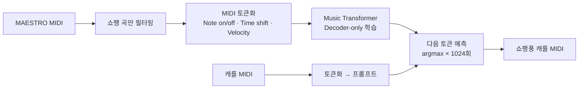

# 🎹 Music Transformer — 쇼팽 스타일 캐롤 생성

| 항목 | 내용 |
|---|---|
| 과목 | 대학원 「인공지능의 원리와 응용」 2025-2, G조 팀 과제 (5명) |
| 주제 | 특정 작곡가 스타일로 학습한 모델이 캐롤 멜로디를 이어 연주 |
| 기반 코드 | Keras 예제 [Music Generation with Transformer Models](https://keras.io/examples/generative/midi_generation_with_transformer/) |
| 논문 | Huang et al., [Music Transformer](https://arxiv.org/abs/1809.04281) (2018) |
| 데이터 | [MAESTRO v3](https://magenta.tensorflow.org/datasets/maestro) 피아노 연주 MIDI (CC BY-NC-SA 4.0) |
| 환경 | Google Colab (GPU), Keras 3, `midi_neural_processor` |

## 전체 흐름

## Music Transformer 핵심 정리

| 개념 | 일반 Transformer | Music Transformer |
|---|---|---|
| 구조 | Encoder + Decoder (번역: 조건부 확률) | **Decoder-only** (음악 시퀀스의 결합 확률), Cross-attention 제거 |
| 위치 정보 | 절대 위치 임베딩 (토큰 1 → 위치 1) | **상대 위치 어텐션**: 토큰 간 거리 `d = i − j`의 임베딩을 점수에 더함 |
| 어텐션 점수 | Content 점수 | Content 점수 **+ Relative position 점수** |
| 계산 방법 | — | **Skewing**: 상대 위치 행렬을 비스듬히 밀어 메모리를 아끼며 계산 |
| 입력 | 단어 토큰 | MIDI 이벤트 토큰 (`Note on 60`, `Velocity 70`, `Time shift 20ms`, `Note off 60`) |

음악은 "몇 번째 음인가"보다 "음과 음 사이가 얼마나 떨어져 있는가"가 중요해서 상대 위치 어텐션이 효과적입니다.

## 실험 과정

| 단계 | 시도 | 결과 / 변경 |
|---|---|---|
| 1 | Keras 예제 그대로 재현 (MAESTRO 전체, 15 epoch) | 기본 피아노 음악 생성 확인 |
| 2 | **베토벤** 곡으로 추가 학습 50회 + 캐롤 앞부분을 프롬프트로 | 캐롤과 어울리지 않는 연주 |
| 3 | **쇼팽**으로 변경, epoch 100으로 증가, 캐롤 1곡을 seed로 | 캐롤 멜로디 + 쇼팽 화성감 |
| 4 | 토큰 시퀀스 제공 방식 개선 (마지막 1024 토큰 입력 → greedy 생성) | 최종 버전 |

## 파일

| 파일 | 설명 |
|---|---|
| `music_transformer_chopin_carol.ipynb` | 쇼팽 곡 필터링 → 학습 → 캐롤 프롬프트 기반 생성 (최종) |
| `samples/*.mid` | 쇼팽 곡을 seed로 생성한 결과 5곡 |

## 실행 시 참고

- `maestro-v3.0.0-midi.zip`과 캐롤 MIDI zip을 Colab에 직접 올려야 합니다.
- 캐롤 원곡과 이를 seed로 만든 결과물은 저작권 때문에 포함하지 않았습니다.
- 노트북의 `mozart_*` 변수명은 이전 실험의 흔적이며 실제로는 `Chopin`으로 필터링합니다.
