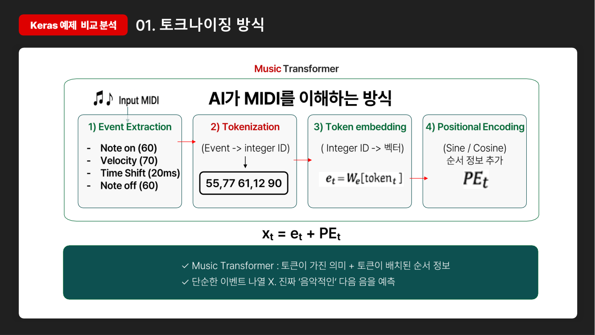
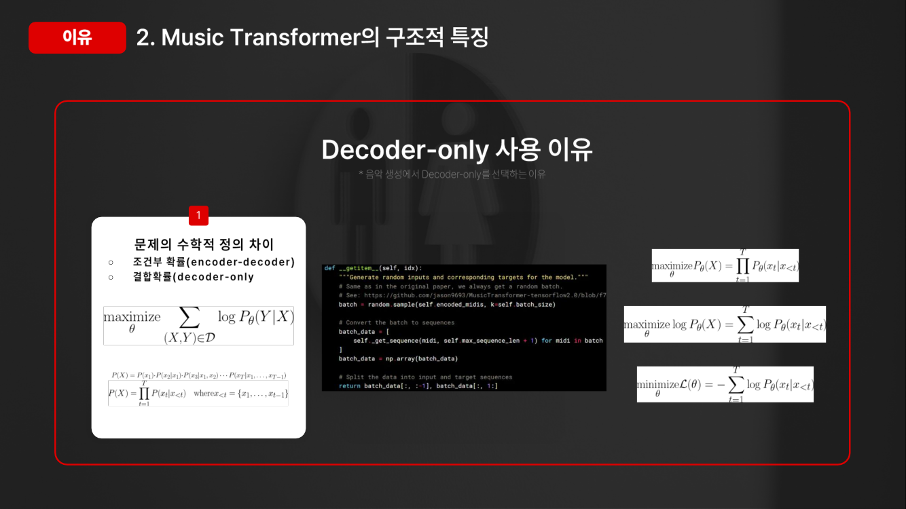
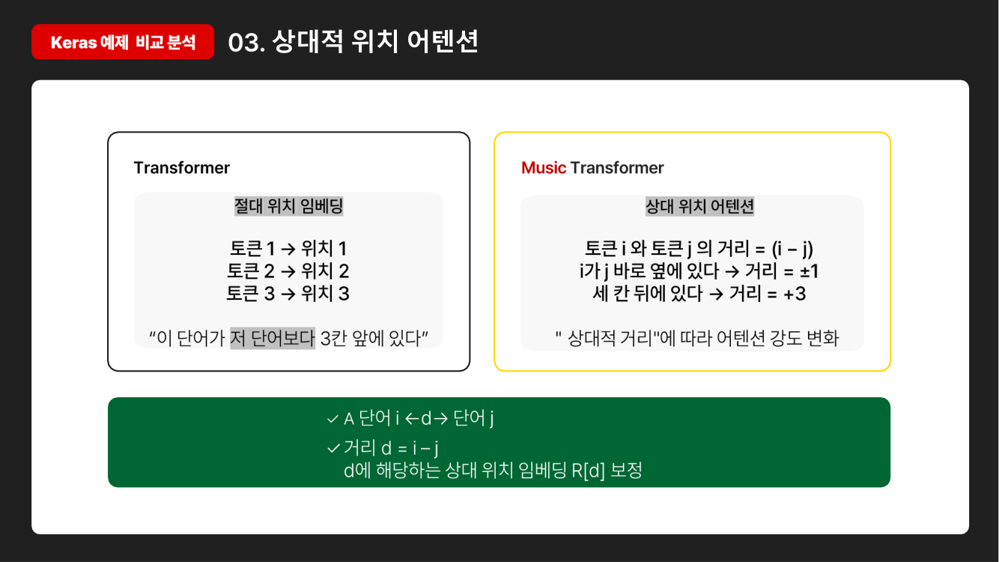
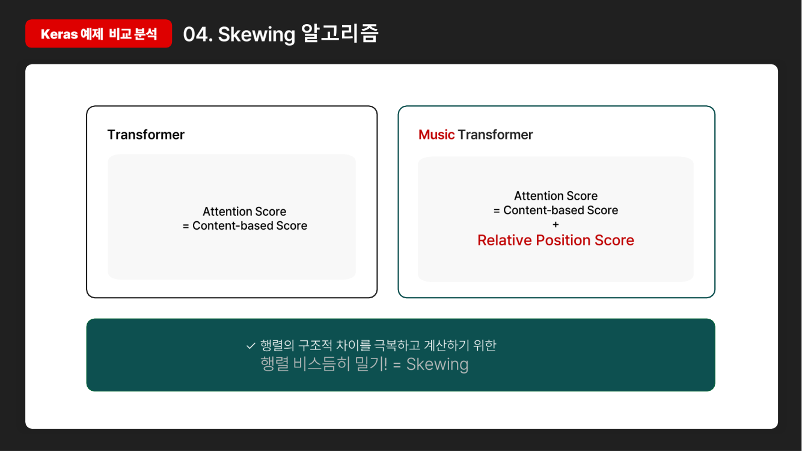
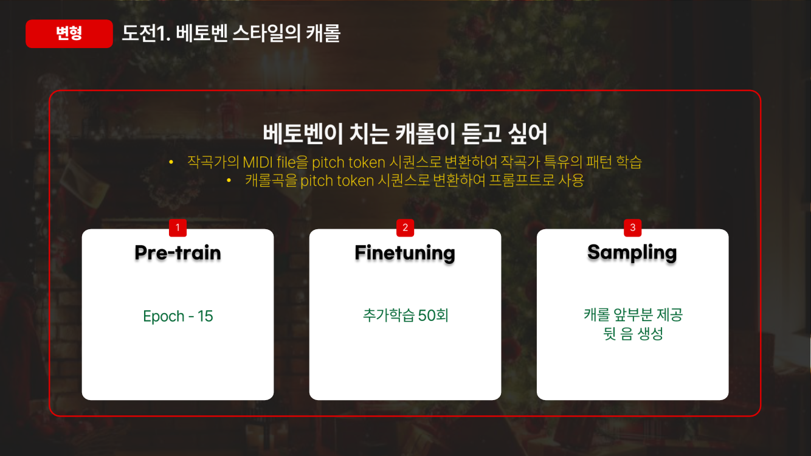
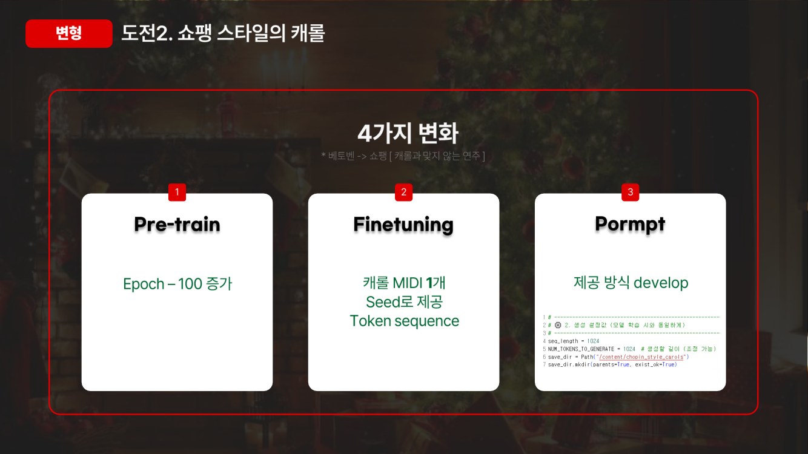
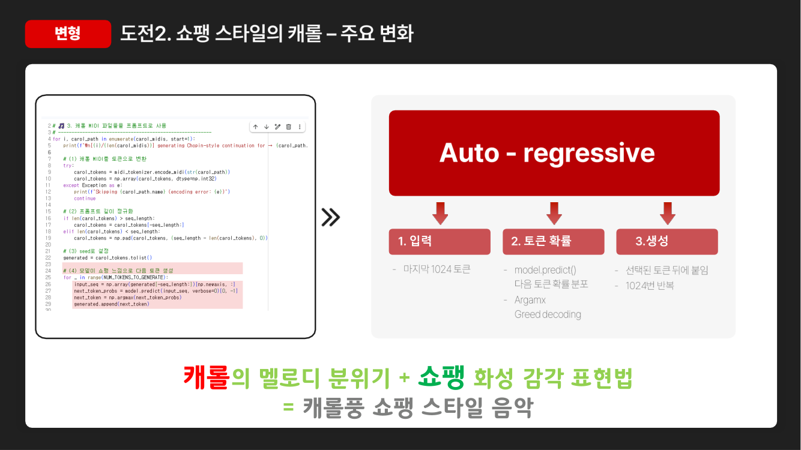

# Music Transformer로 쇼팽 스타일 피아노 곡 생성하기
#### (대학원 수업 프로젝트)

> 음악 생성 모델 Music Transformer의 구조를 분석하고,<br>
> 쇼팽 피아노 연주로 학습한 모델로 곡을 생성한 뒤<br>
> 결과가 정말 새로 만든 음인지 원곡과 대조해 검증한 프로젝트입니다.

## 프로젝트 개요

- **목표**: Music Transformer 구조를 분석하고,<br>
  특정 작곡가 스타일로 곡을 이어서 연주하는 생성 모델 구현
- **내용**: Music Transformer 모델 분석, 쇼팽 스타일 곡 생성,<br>
  캐롤 파인튜닝, 생성 결과 검증
- **방법**: Music Transformer 논문(Huang et al., 2018)을 구현한<br>
  Keras 공식 예제를 바탕으로 쇼팽 곡만 골라 학습한 뒤 캐롤로 추가 학습
- **결과**: 캐롤 파인튜닝 후 이어 연주의 음 구성이 원곡과 더 비슷해짐(유사도 0.54 → 0.87),<br>
  원곡·학습 데이터를 베끼지 않은 새 연주임을 검증 ([바로 듣기](https://mjk022.github.io/portfolio/music/))

## 프로젝트 목표

ChatGPT 같은 언어 모델은 "다음에 올 단어"를 예측하며 문장을 만듭니다.<br>
음악도 음표가 순서대로 이어진 것이니, 같은 원리로 "다음에 올 음"을 예측하면 작곡을 할 수 있습니다.<br>
이 아이디어를 구현한 것이 Google의 **Music Transformer**입니다.

이 프로젝트에서는 모델 구조를 분석하는 데서 그치지 않고<br>
**"특정 작곡가의 스타일을 배운 모델에게 익숙한 노래를 들려주면 어떻게 이어서 연주할까?"**<br>
라는 질문을 실험해 보는 것을 목표로 했습니다.

## 핵심 개념

**음악을 숫자로 바꾸기 (토큰화)**

MIDI 파일은 악보 대신 "어떤 건반을 눌렀다", "얼마나 세게",<br>
"몇 밀리초 뒤에", "건반을 뗐다" 같은 연주 기록을 담은 파일입니다.<br>
이 기록 하나하나를 숫자(토큰)로 바꾸면, 문장의 단어처럼 모델이 읽을 수 있습니다.

```
건반 60 누름 → 세기 70 → 20ms 대기 → 건반 60 뗌
      ↓
   [55, 77, 61, 12, 90]
```



**Music Transformer가 일반 Transformer와 다른 점**

| 구분 | 일반 Transformer (번역 등) | Music Transformer |
|---|---|---|
| 구조 | 원문을 읽는 부분 +<br>번역문을 쓰는 부분 | **쓰는 부분(Decoder)만** 사용<br>앞에 나온 음을 보고 다음 음만 이어 붙이면 되기 때문 |
| 위치 정보 | "몇 번째 단어인가"<br>(절대 위치) | **"앞 음과 얼마나 떨어져 있는가"**<br>(상대 위치) |

발표에서는 Keras 예제 코드의 Query·Key·Value 입력과 마스킹 구조를 근거로<br>
Decoder-only 구조임을 확인하고,<br>
음악 생성이 조건부 확률이 아닌 결합 확률 문제라는 점에서 그 이유를 설명했습니다.



음악에서는 같은 멜로디가 다른 위치에서 반복되는 경우가 많습니다.<br>
그래서 "3번째 음"이라는 절대 위치보다 "두 음 사이 간격"이라는 상대 위치가 더 중요하고,<br>
이것이 Music Transformer의 핵심인 **상대 위치 어텐션**입니다.<br>
이를 메모리를 적게 쓰며 계산하기 위해<br>
행렬을 비스듬히 밀어 정렬하는 **Skewing** 기법을 사용합니다.





## 수행 내용


**① 기본 예제 재현**

Keras 공식 예제를 그대로 실행해,<br>
국제 피아노 콩쿠르 연주 기록인 MAESTRO 데이터셋 전체로 학습한 모델이<br>
피아노 곡을 만드는 것을 확인했습니다.

**② 베토벤으로 첫 시도**

베토벤 곡만 골라 추가 학습한 뒤 캐롤 앞부분을 들려줬습니다.<br>
그런데 베토벤 특유의 무겁고 극적인 연주가 이어져,<br>
캐롤의 밝은 분위기와 어울리지 않았습니다.



**③ 쇼팽으로 변경**

서정적인 선율이 많은 쇼팽으로 작곡가를 바꿔 학습하고,<br>
캐롤을 시작 부분(seed)으로 주어 이어서 연주하게 했습니다.





**④ 생성 결과 검증**

생성한 MIDI가 정말 새로 만든 음인지 확인하기 위해,<br>
결과 파일을 입력한 캐롤 원곡과 MAESTRO의 쇼팽 연주 201곡에 각각 겹쳐 보고<br>
같은 높이의 음이 같은 시점(±0.05초)에 나오는 음표의 비율을 계산했습니다.

그 결과 캐롤을 넣어 만든 결과물은 **원곡 마지막 47초와 음표 227개가 100% 같아**,<br>
모델이 새 음을 만들지 못하고 입력한 원곡을 그대로 저장한 것으로 확인되어 결과에서 제외했습니다.<br>
노트북 코드를 확인해 보니 원인은 세 가지였습니다.

| 원인 | 결과 | 개선 방법 |
|---|---|---|
| 매번 확률이 가장 높은<br>토큰만 선택(argmax) | 같은 토큰이 반복되어<br>음표가 생기지 않음 | 확률에 따라 무작위로<br>고르는 샘플링 |
| 곡의 마지막 1024개 토큰을<br>입력으로 사용 | 저장된 파일이<br>원곡 뒷부분이 됨 | 곡의 앞부분(첫 소절)을<br>입력으로 사용 |
| 짧은 곡 앞을 0으로 채움 | 0은 "0번 음을 누른다"는 실제 명령이라<br>입력이 오염됨 | 채우기를 하지 않음 |

**⑤ 저장된 모델로 캐롤 다시 생성**

학습이 끝난 모델 파일(`music_transformer.keras`)로 위 세 가지를 고쳐 다시 생성했습니다.<br>
작업한 PC에서는 Keras가 쓰는 계산 라이브러리(TensorFlow·PyTorch·JAX)가 실행되지 않아,<br>
노트북의 모델 구조를 NumPy로 그대로 옮겨 저장된 가중치를 불러왔습니다(`regenerate/`).

| 확인 항목 | 결과 |
|---|---|
| NumPy 구현이 원래 모델 계산과 같은지 | 한 번에 계산한 값과 한 토큰씩 계산한 값의 차이 최대 0.000003 |
| 가중치를 제대로 불러왔는지 | 쇼팽 연주에 대한 손실 4.876<br>(노트북 학습 기록의 검증 손실 4.906과 비슷, 무작위 모델은 5.97) |
| 상위 5개 후보에서만 고르기(top-5) | 시간·세기 토큰만 나오고 음표는 0개<br>(음표 확률이 128개 음높이로 나뉘어 상위 5개에 들지 못함) |
| 전체 확률분포에서 고르기 | 시간·세기·음표 토큰이 원곡과 비슷한 비율로 생성 |

전체 확률분포에서 고르는 방식으로 캐롤 「Christmas Without You」 앞부분 26초(512개 토큰)를 들려주고<br>
1024개 토큰을 이어서 만들게 했습니다.

**⑥ 캐롤 파인튜닝**

원래 노트북에는 캐롤을 학습하는 단계가 없어, 캐롤은 생성할 때 시작 부분으로만 쓰였습니다.<br>
그래서 쇼팽으로 학습한 모델에 캐롤 MIDI를 추가로 학습시켰습니다<br>
(Colab GPU, `music_transformer_carol_finetune.ipynb`).

| 설정 | 내용 |
|---|---|
| 학습 데이터 | 캐롤 35곡 학습, 5곡 검증<br>평가용 「Christmas Without You」는 학습에서 제외 |
| 학습률 | 1e-4 (쇼팽 스타일을 한꺼번에 잊지 않도록 낮게) |
| 멈춤 기준 | 검증 손실이 3번 연속 나아지지 않으면 멈추고<br>가장 좋은 모델 사용 |
| 생성 | 평가용 곡 앞부분 512토큰을 들려주고 1024토큰 생성<br>(전체 확률분포에서 샘플링) |
| 학습 결과 | 30 epoch 동안 검증 손실 4.82 → 3.83<br>끝까지 계속 줄어 조기 종료되지 않음 |

## 결과

### [▶ 생성곡 바로 듣기](https://mjk022.github.io/portfolio/music/)

위 링크를 누르면 브라우저에서 생성곡을 피아노 소리로 바로 재생하고,<br>
음이 진행되는 피아노 롤로 볼 수 있습니다.

**캐롤 이어 연주: 파인튜닝 전/후**

같은 캐롤 앞부분 26초를 들려주고, 두 모델이 이어 연주한 결과를 원곡의 실제 다음 부분과 비교했습니다.

| 구간 | 음 구성 유사도<br>(원곡 대비) | 음역 | 1초당 음표 수 |
|---|---|---|---|
| 원곡의 실제 다음 부분 | 0.97 | 55~83 | 5.0개 |
| 쇼팽만 배운 모델 | 0.54 | 37~106 | 5.8개 |
| **캐롤을 추가 학습한 모델** | **0.87** | **55~81** | 2.4개 |

음 구성 유사도는 12개 음이름(도·레·미…)이 쓰인 비율이 원곡과 얼마나 비슷한지를 0~1로 나타낸 값입니다.<br>
추가 학습 뒤에는 원곡의 조성과 음역을 훨씬 잘 따라갔습니다.

| 구간 | 원곡과<br>겹치는 음 | 캐롤 41곡과<br>겹치는 음 (최대) | 쇼팽 201곡과<br>겹치는 음 (최대) |
|---|---|---|---|
| 쇼팽만 배운 모델 | 4.7% | 8.7% | 20.3% |
| 캐롤을 추가 학습한 모델 | 8.4% | 15.1% | 19.3% |

두 결과 모두 어느 곡과도 겹치는 음이 20% 안팎이라,<br>
원곡이나 학습한 캐롤을 베낀 것이 아니라 새로 만든 연주입니다.<br>
듣기 페이지에서 네 가지(들려준 앞부분, 파인튜닝 전, 후, 원곡의 다음 부분)를 차례로 들어볼 수 있습니다.

**쇼팽 연주를 시작으로 생성한 샘플**

쇼팽 연주로 학습한 모델이 만든 5곡을 MAESTRO의 쇼팽 연주 201곡과 대조한 결과입니다.

| 샘플 | 길이 | 비교 원곡 구간 (MAESTRO) | 겹치는 음 | 해석 |
|---|---|---|---|---|
| 샘플 1 | 59초 | 에튀드 Op.25 전곡 연주<br>18:04~19:04 | 약 21% 이하 | 대부분 새로 만든 음 |
| 샘플 2 | 26초 | 에튀드 Op.25 No.10<br>0:22~0:50 | 약 14% 이하 | 대부분 새로 만든 음 |
| 샘플 3 | 26초 | 에튀드 Op.25 No.5<br>2:43~3:04 | 앞 1/4 구간 65%,<br>이후 2~22% | 원곡 일부로 시작한 뒤<br>새로 이어 감 |
| 샘플 4 | 14초 | 에튀드 Op.25 No.11<br>3:25~3:39 | 앞 3/4 구간 59~73%,<br>마지막 1/4 0% | 대부분 원곡과 같고<br>끝부분만 새로 생성 |
| 샘플 5 | 77초 | 에튀드 Op.25 No.6<br>0:22~1:44 | 약 15% | 대부분 새로 만든 음 |

비교 원곡 구간은 각 샘플과 가장 잘 맞는 쇼팽 연주에서 샘플 길이만큼 잘라 낸 것으로,<br>
듣기 페이지에서 생성곡 바로 아래에 두어 함께 들어볼 수 있습니다.

## 한계 및 개선 방향

- top-5 샘플링에서 음표가 하나도 나오지 않을 만큼 모델의 확률분포가 퍼져 있어,<br>
  학습이 충분하지 않습니다.
- 캐롤 추가 학습 후 1초당 음표 수가 2.4개로 원곡(5.0개)보다 적어,<br>
  연주가 느리고 성기게 들립니다.
- 캐롤 추가 학습은 30 epoch 끝까지 검증 손실이 줄고 있어,<br>
  더 학습하면 캐롤다운 리듬을 더 살릴 여지가 있습니다.
- 노트북 기록 기준 10 epoch 학습 뒤 검증 손실은 4.91로,<br>
  더 오래 학습하면 쇼팽다운 화성과 리듬을 더 잘 살릴 수 있습니다.
- 생성 결과를 "얼마나 쇼팽 같은가"로 평가하는 정량 지표는 사용하지 못했습니다.

## 파일 구성

| 파일 | 설명 |
|---|---|
| `music_transformer_chopin_carol.ipynb` | 쇼팽 곡 선별 → 학습 → 캐롤 프롬프트 기반 생성 |
| `music_transformer_carol_finetune.ipynb` | 학습된 쇼팽 모델에 캐롤 추가 학습 →<br>파인튜닝 전/후 이어 연주 생성 |
| `samples/carol/` | 캐롤 이어 연주: 들려준 앞부분, 파인튜닝 전·후 이어 연주,<br>원곡의 실제 다음 부분 |
| `samples/chopin_style_*.mid` | 쇼팽 스타일 생성곡 5곡 |
| `samples/originals/original_for_*.mid` | 생성곡마다 가장 비슷한 MAESTRO 쇼팽 연주 구간<br>(웹 재생 속도를 위해 음량을 4단계로 단순화) |
| `regenerate/` | 저장된 모델을 NumPy로 실행하는 코드(`mtnp.py`), 검증(`check.py`),<br>캐롤 생성(`gen_carol.py`), 겹치는 음 계산(`verify_new.py`) |
| `images/` | 발표 자료 중 주요 슬라이드 |

## 참고

- 기반 코드: Keras 예제 [Music Generation with Transformer Models](https://keras.io/examples/generative/midi_generation_with_transformer/)
- 논문: Huang et al., [Music Transformer](https://arxiv.org/abs/1809.04281) (2018)
- 데이터: [MAESTRO v3](https://magenta.tensorflow.org/datasets/maestro) (CC BY-NC-SA 4.0)<br>
  `samples/originals/`의 비교 구간은 MAESTRO 연주 MIDI를 잘라 낸 것으로, 같은 라이선스를 따릅니다.
- 실행 환경: Google Colab (GPU), Keras 3<br>
  MAESTRO zip과 캐롤 MIDI zip은 Colab에 직접 올려야 합니다.<br>
  캐롤 원곡은 비교를 위해 앞부분과 다음 부분(0:00~0:57)만 포함했으며, 저작권은 원저작자에게 있습니다.<br>
  학습된 모델 파일(34MB)은 저장소에 포함하지 않았습니다.
- 노트북의 `mozart_*` 변수명은 이전 실험의 흔적이며, 실제로는 쇼팽 곡으로 필터링합니다.
