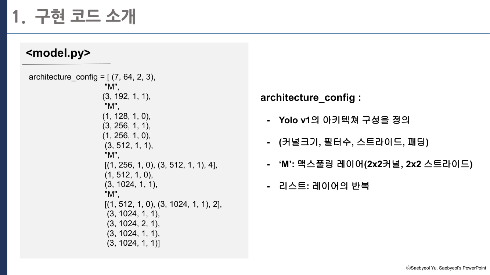
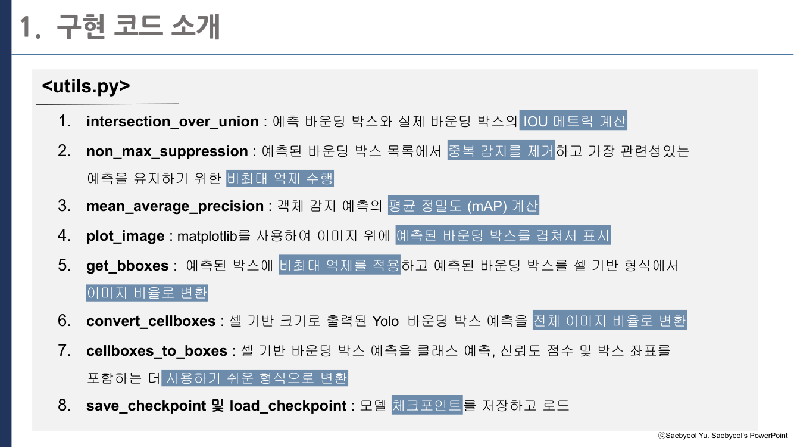
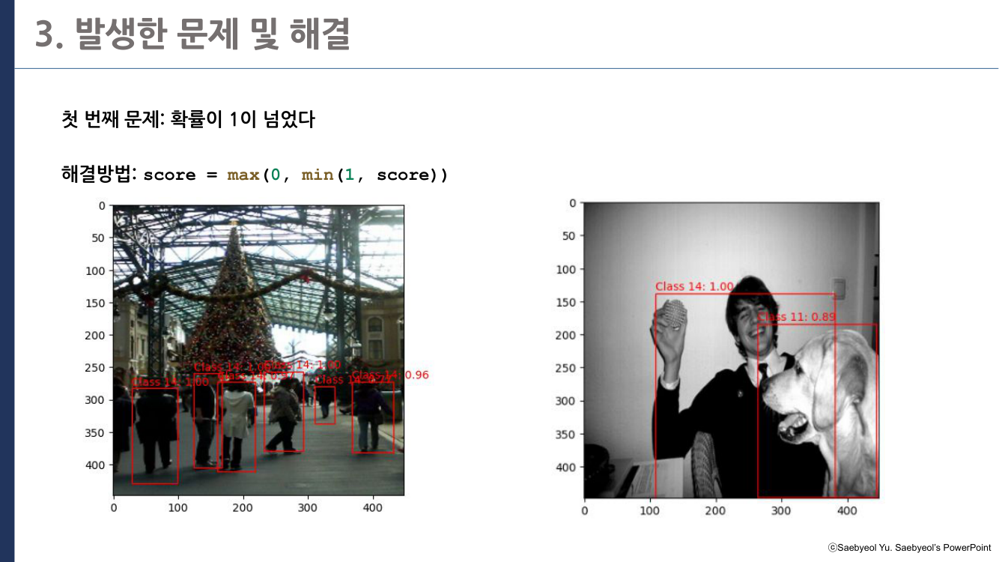
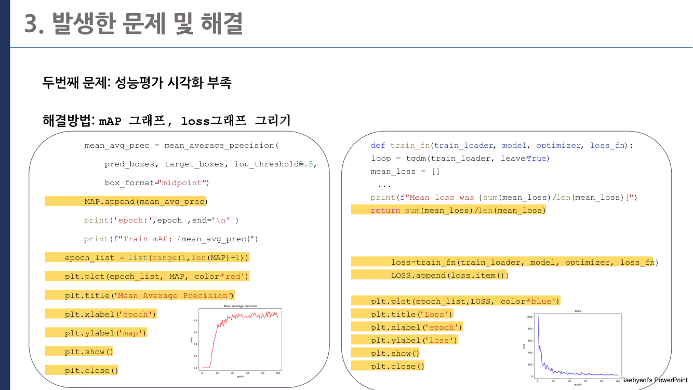
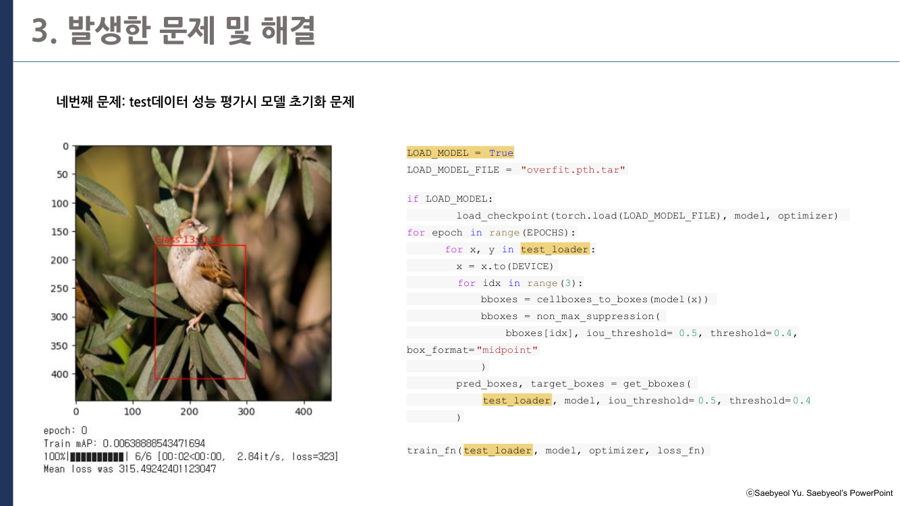
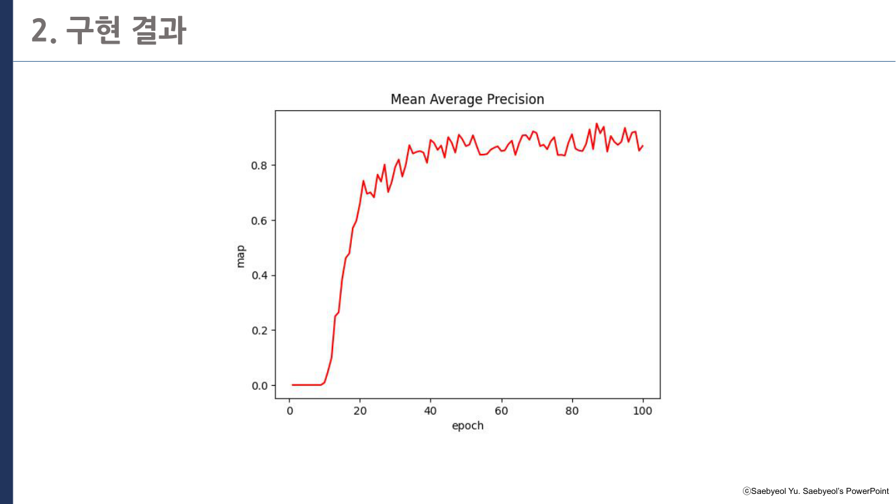
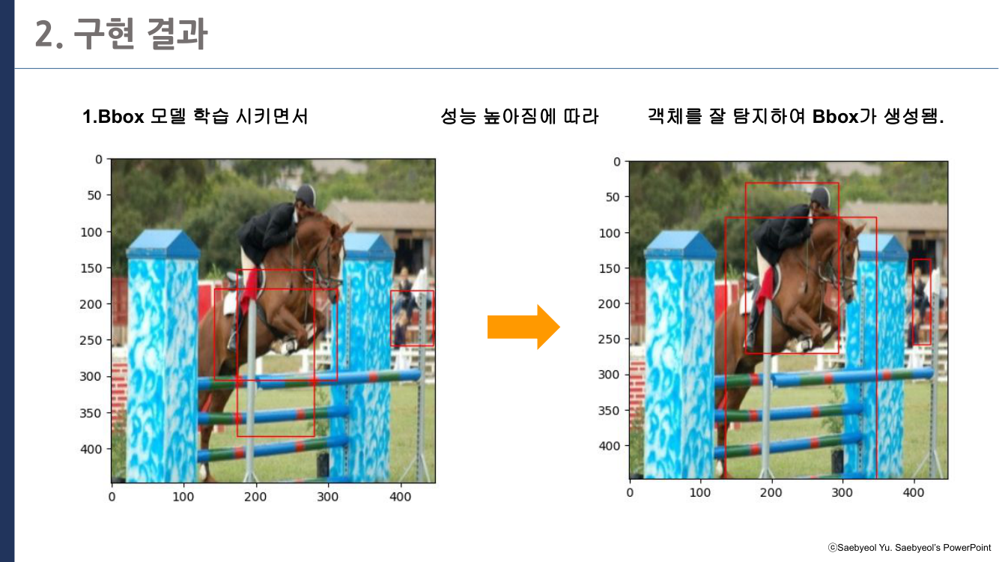

# YOLO v1 논문 직접 구현하기
#### (학회 프로젝트)

> 사진 속 물체를 찾아 네모 박스로 표시하는 객체 탐지 모델 YOLO v1을, 
> 논문을 읽고 PyTorch 코드로 직접 구현한 프로젝트입니다.

## 프로젝트 개요

- **목표**: 객체 탐지 논문 YOLO v1을 코드로 재현하고, 
  결과를 해석하기 쉬운 형태로 시각화
- **내용**: YOLO v1 객체 탐지 모델 구현 및 결과 시각화 기능 추가
- **방법**: 공개 구현 코드를 한 줄씩 해석하며 
  재구현 → 클래스·확률·그래프 표시 기능 추가 → 오류 해결
- **결과**: 자동차, 사람, 비행기 등을 탐지해 박스와 이름, 확률을 표시하는 모델 완성

## 프로젝트 목표

컴퓨터 비전 분야의 대표 논문인 YOLO v1을 PyTorch로 직접 구현하는 것이 목표였습니다. 
논문의 모델 구조, 손실 함수, 평가 지표가 코드에서 각각 어떻게 구현되는지 확인하고, 
학습 결과를 박스·클래스·확률·학습 곡선으로 시각화해 
모델의 동작을 한눈에 보여주고자 했습니다.

## 핵심 개념: YOLO의 동작 방식

이전의 객체 탐지 모델은 "물체가 있을 것 같은 후보 영역"을 먼저 수천 개 찾은 뒤, 
각 영역을 따로 검사했습니다. 
정확하지만 느렸습니다.

YOLO(You Only Look Once)는 이름 그대로 
**이미지를 한 번만 보고** 모든 물체의 위치와 종류를 동시에 예측합니다.

1. 이미지를 7×7 = 49칸의 격자로 나눕니다.
2. 각 칸은 "내 안에 물체의 중심이 있다면, 그 물체의 박스는 어디이고 무엇인가"를 예측합니다.
3. 여러 칸이 같은 물체에 박스를 그리면, 가장 확실한 박스만 남기고 나머지를 지웁니다(NMS).

## 수행 내용

**① 논문 구조를 코드로 구현**

논문의 구성 요소를 파일 단위로 나눠 구현했습니다. 
모델 구조는 `(커널 크기, 필터 수, 스트라이드, 패딩)` 목록으로 정의하고, 
이를 읽어 합성곱 층을 자동으로 쌓도록 만들었습니다.

| 파일 | 역할 |
|---|---|
| `Data/getdata.ipynb` | Pascal VOC 데이터 다운로드, 라벨 변환 |
| `Data/dataset.ipynb` | 이미지와 정답 박스를 7×7 격자 형태로 변환 |
| `model.ipynb` | 합성곱 블록(`CNNBlock`)과 전체 모델(`Yolov1`) |
| `loss.ipynb` | 손실 함수: 박스 위치, 물체 유무, 클래스를 얼마나 틀렸는지 계산 |
| `utils.ipynb` | 박스 겹침 정도(IoU), 중복 박스 제거(NMS), 정확도(mAP) 계산, 시각화 |
| `train_*.ipynb` | 학습 및 결과 시각화 |

`utils.ipynb`에는 객체 탐지에 필요한 보조 함수 8개를 구현했습니다.

**② 결과를 보기 쉽게 기능 추가**

참고한 원본 코드는 박스만 그려 주어서, 모델이 무엇을 탐지했는지 알기 어려웠습니다. 
그래서 단계적으로 기능을 추가했습니다.

| 단계 | 노트북 | 추가한 기능 |
|---|---|---|
| 1 | `train_bbox + class.ipynb` | 박스에 물체 이름(클래스) 표시 |
| 2 | `train_bbox + class + 확률.ipynb` | 이름과 함께 확신 정도(확률) 표시 |
| 3 | `train_bbox + class + 확률 + 그래프.ipynb` | 학습이 진행되며 오차와 정확도가 어떻게 변하는지 그래프로 표시 |

**③ 학습 중 생긴 문제 해결**

| 문제 | 해결 |
|---|---|
| 표시되는 확률이 1(100%)을 넘음 | `score = max(0, min(1, score))`로 0~1 범위로 제한 |
| 학습이 잘 되고 있는지 판단하기 어려움 | 매 학습 회차(epoch)마다 정확도(mAP)와 오차(Loss)를 기록해 그래프로 시각화 |
| 같은 회차가 중복으로 학습됨 | 학습 반복문 구조를 정리 |
| 테스트할 때 학습된 모델이 초기화됨 | 저장해 둔 학습 결과(체크포인트)를 불러와 평가하도록 수정 |

## 결과

**1단계: 박스 + 물체 이름**

**2단계: 박스 + 물체 이름 + 확률**

 

**3단계: 학습 경과 그래프 (오차는 줄고 정확도는 오름)**

학습 초기에는 박스가 엉뚱한 곳에 그려졌지만, 
학습이 진행될수록 자동차, 사람, 비행기 같은 물체의 위치에 맞게 박스가 잡혔습니다.

탐지할 수 있는 물체는 Pascal VOC 데이터셋의 20종입니다.

| 분류 | 클래스 (번호) |
|---|---|
| 탈것 | 비행기 0, 자전거 1, 배 3, 자동차 6, 오토바이 13, 기차 18 |
| 동물·사람 | 새 2, 고양이 7, 개 11, 말 12, 사람 14, 양 16 |
| 실내 물건 | 병 4, 의자 8, 테이블 10, 화분 15, 소파 17, 모니터 19 |

## 참고

- 발표 자료의 주요 슬라이드는 `images/` 폴더에 있습니다.
- 논문: Redmon et al., [You Only Look Once: Unified, Real-Time Object Detection](https://arxiv.org/abs/1506.02640) (2016)
- 참고 코드: [aladdinpersson/Machine-Learning-Collection — YOLO](https://github.com/aladdinpersson/Machine-Learning-Collection/tree/master/ML/Pytorch/object_detection/YOLO)
- 학습 데이터: Pascal VOC 100장 샘플 `Data/100examples.csv` ([Kaggle](https://www.kaggle.com/datasets/734b7bcb7ef13a045cbdd007a3c19874c2586ed0b02b4afc86126e89d00af8d2))
- 환경: PyTorch, Google Colab
