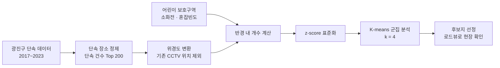

# 불법 주정차 단속 CCTV 추가 설치 장소 선정 (2023 광진구 빅데이터 분석 공모전)

> 광진구의 불법 주정차 단속 기록을 분석해, 
> 단속이 잦으면서 어린이 보호구역·소화전이 가까운 곳을 찾아 
> 단속 CCTV를 새로 설치할 최적의 장소를 제안한 프로젝트입니다.

## 프로젝트 개요

- **목표**: 불법 주정차가 잦고 사고 위험이 큰 지점을 데이터로 찾아 단속 CCTV 추가 설치 장소 제안
- **내용**: 2017~2023년 광진구 불법 주정차 단속 데이터 분석 및 설치 후보지 선정
- **방법**: 단속 건수 상위 200곳 추출 → 어린이 보호구역·소화전·교통 혼잡도 결합 → 
  표준화 후 K-means 군집 분석 → 기존 CCTV 위치와 비교
- **결과**: 기존 CCTV가 없는 설치 후보지 2곳(올포유 앞, 광장동 570) 선정

## 프로젝트 목표

광진구는 서울시 자치구 중 불법 주정차 단속 CCTV가 58개로 가장 적고, 
자동차 등록 대수에 비해서도 CCTV가 부족한 편입니다. 
불법 주정차는 좁은 골목에서 보행자 안전을 위협하고, 소방차의 현장 도착을 늦추기도 합니다.

그래서 단속 기록과 주변 시설 정보를 함께 분석해, 
**CCTV를 새로 설치했을 때 효과가 가장 클 장소**를 데이터로 찾는 것을 목표로 했습니다.

## 사용 데이터

| 데이터 | 사용한 내용 | 출처 |
|---|---|---|
| 서울특별시 광진구 주정차 단속현황 | 2017~2023년 단속 장소, 단속 일시 | 공공데이터포털 |
| 광진구 불법주정차 위반단속 CCTV 위치정보 | 기존 단속 CCTV 58곳의 위치 | 공공데이터포털 |
| 서울시 불법주정차·전용차로 위반 단속 CCTV 위치정보 | 서울시 자치구별 CCTV 수 비교 | 공공데이터 |
| 어린이 보호구역 위치 | 단속 지점 주변의 어린이 보호구역 수 | 공공데이터포털 |
| 광진구 소방용수시설 | 단속 지점 주변의 소화전 수 | 공공데이터포털 |
| 동별 교통 혼잡빈도강도 | 불법 주차로 인한 교통 체증 가능성 | 공공데이터 |
| 서울 행정구역 경계 GeoJSON | 구·동 경계 지도 시각화 | southkorea/seoul-maps |

## 수행 내용

**① 단속 데이터 정제와 상위 200곳 추출**

같은 단속 지점이 띄어쓰기나 표기 차이로 다르게 입력된 경우가 많아, 
공백을 제거하고 같은 장소를 하나로 합쳤습니다. 
주소가 잘못 입력된 지점(광진구에 없는 주소 등)은 제거했습니다. 
이후 단속 건수 기준 상위 200곳을 추리고, 기존 CCTV 58곳과 
2023년 상반기 신규 설치 예정 5곳은 후보에서 제외했습니다.

**② 연도별 단속 현황과 지도 시각화**

연도별로 단속이 많은 지점을 꺾은선·막대 그래프로 비교하고, 
단속 위치와 기존 CCTV 위치를 지도에 함께 표시해 CCTV가 비어 있는 구역을 확인했습니다. 
또 연도별 단속 횟수의 증감률을 계산해, 최근 단속이 급증한 지점을 따로 표시했습니다.

**③ 위험 요소 결합**

단속 지점마다 주변의 어린이 보호구역 수, 소화전 수, 동별 교통 혼잡빈도강도를 붙였습니다. 
어린이 보호구역과 소화전 주변은 법적으로 주정차가 금지된 곳이고, 
혼잡도가 높은 곳은 불법 주차가 교통 체증으로 이어지기 쉽기 때문입니다.

**④ 군집 분석**

변수마다 단위가 달라 값이 큰 변수가 결과를 좌우하지 않도록 z-score로 표준화했습니다. 
Elbow 방법으로 군집 수를 4개로 정하고, PCA로 2차원에 시각화해 군집을 확인했습니다. 
K-means는 초기값에 따라 결과가 달라지므로 3번 실행해 공통으로 뽑힌 장소를 후보로 삼았고, 
**① 단속 건수가 많은 곳, ② 어린이 보호구역과 소화전이 많은 곳** 순으로 우선순위를 두었습니다.

## 결과

| 후보지 | 선정 이유 | 최종 |
|---|---|---|
| 올포유 앞 | 바로 앞 횡단보도, 혼잡빈도강도 63% 이상 | **선정** |
| 광장동 570 | 어린이 보호구역이자 복합단지 밀집 지역, 혼잡빈도강도 63% 이상 | **선정** |
| 군자역 5번 출구 가구할인매장 앞 | 우회전 시 시야 방해로 사고 위험 | 제외 (로드뷰 확인 결과 데이터에 없는 CCTV가 이미 설치됨) |

선정한 장소에 CCTV를 설치하면 악성 불법 주정차를 줄여 보행자와 운전자의 안전을 높이고, 
과태료 수입 증가와 단속 인력 절감 효과도 기대할 수 있습니다. 
나아가 CCTV 주변의 공영주차장 확충 근거 자료로도 활용할 수 있다고 제안했습니다.

**지도 바로 보기** (클릭하면 브라우저에서 확대·축소할 수 있습니다)

| 지도 | 내용 |
|---|---|
| [단속 위치 + 기존 CCTV](https://mjk022.github.io/portfolio/gwangjin-cctv/enforcement_all_cctv.html) | 2017~2023년 단속 지점(파란색)과 기존 CCTV(빨간색) |
| [동별 단속 위치 + 기존 CCTV](https://mjk022.github.io/portfolio/gwangjin-cctv/enforcement_dong_cctv.html) | 동 경계를 함께 표시 |
| [단속 Top 200 + 기존 CCTV](https://mjk022.github.io/portfolio/gwangjin-cctv/top200_cctv.html) | 단속이 가장 많은 200곳과 기존 CCTV 비교 |
| [신규 설치 예정 5곳 + Top 200 + 기존 CCTV](https://mjk022.github.io/portfolio/gwangjin-cctv/candidates_top200_cctv.html) | 2023년 신규 설치 예정 위치까지 포함 |
| [단속 증감률](https://mjk022.github.io/portfolio/gwangjin-cctv/growth_rate.html) | 원이 클수록 최근 단속이 급증한 지점 |
| [단속 증감률 + 어린이 보호구역](https://mjk022.github.io/portfolio/gwangjin-cctv/growth_rate_school_zone.html) | 어린이 보호구역 위치를 함께 표시 |

## 한계 및 개선 방향

- 단속 건수, 혼잡도, 보호구역·소화전 수 외에 유동인구, 도로 폭 같은 변수를 더 반영할 수 있습니다.
- 원본 단속 데이터의 주소 오류를 정리하는 데 시간이 많이 들어, 
  K-means 외의 군집 방법(DBSCAN 등)과 비교하지 못했습니다.
- 데이터에 없는 CCTV가 실제로 있었던 것처럼, 공공데이터만으로는 현장을 완전히 반영하지 못해 
  로드뷰 같은 현장 확인이 반드시 필요했습니다.

## 파일 구성

| 파일 | 설명 |
|---|---|
| `불법주정차_CCTV_위치선정.ipynb` | 데이터 정제, 연도별 분석, 지도 시각화, 증감률 분석, 군집 분석 |

분석 과정에서 작성한 노트북으로, 일부 탐색용 셀은 실행 결과가 저장되어 있지 않습니다. 
노트북 안의 지도는 GitHub에서 표시되지 않아 빼고 위의 링크로 옮겼으며, 
데이터 파일은 포함하지 않았습니다.
