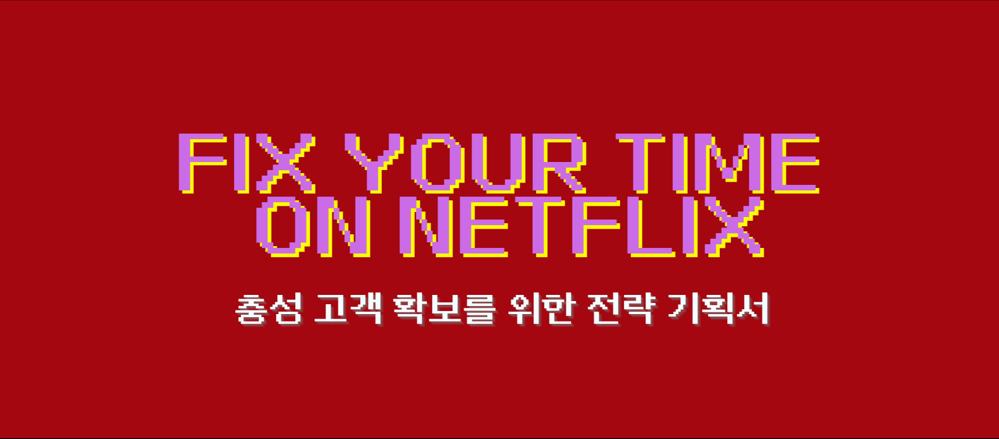
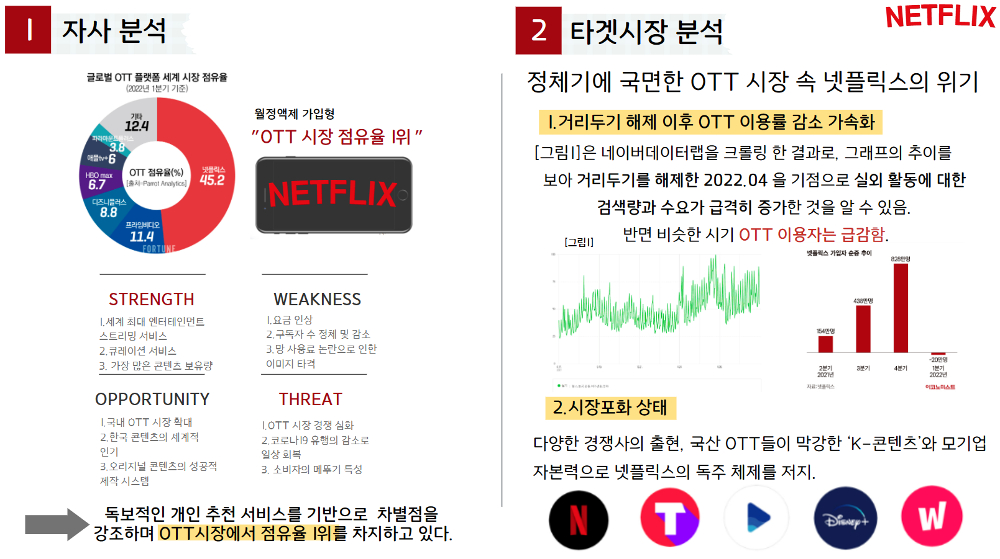
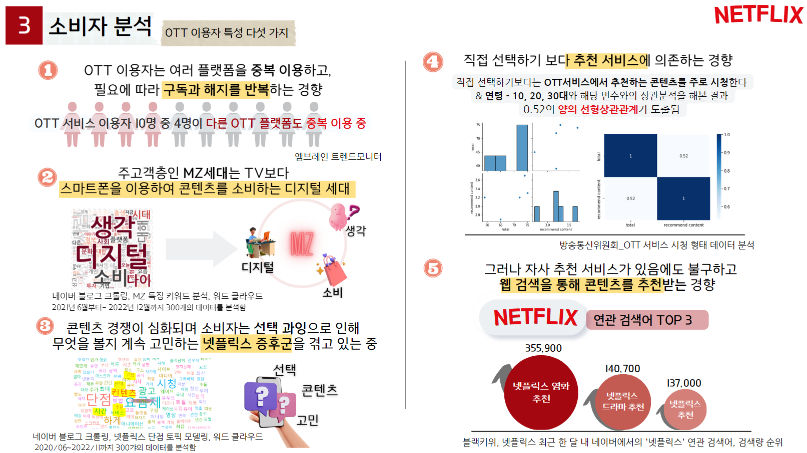
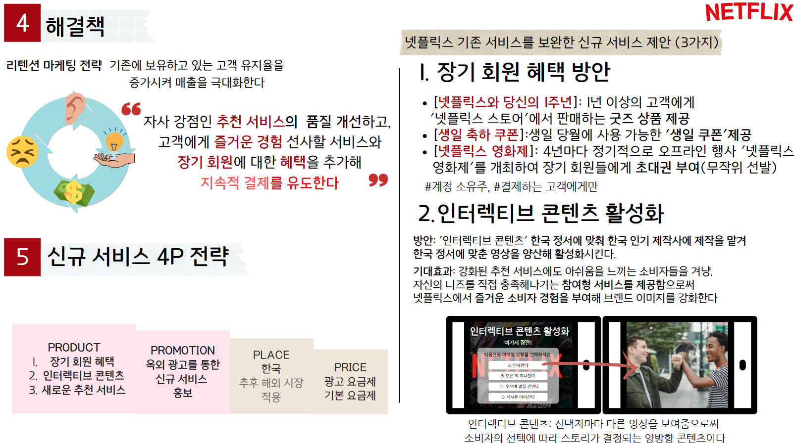
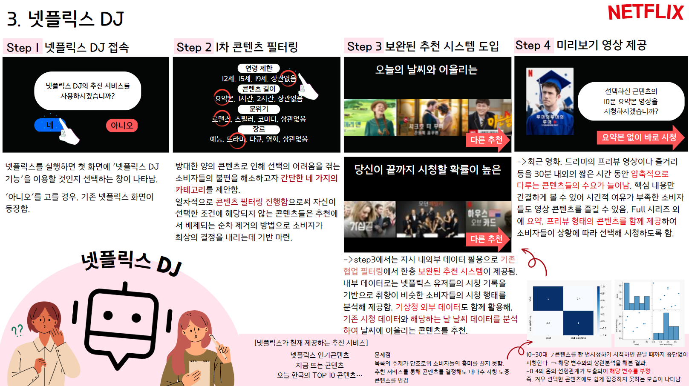
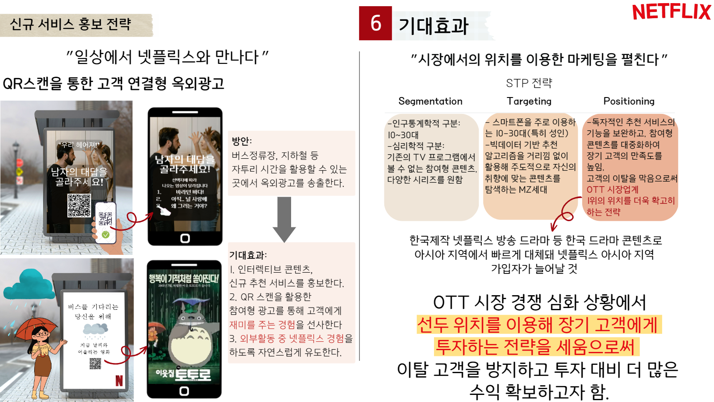

# 넷플릭스 충성 고객 확보를 위한 데이터 마케팅 전략
#### (교내 마케팅 전략 기획 공모전 · 데이터 마케팅 부문)

> 블로그·지식인·앱 리뷰와 공공데이터를 분석해, 
> 넷플릭스 이용자가 "볼 게 많은데 볼 게 없는" 넷플릭스 증후군을 겪고 있음을 확인하고 
> 이탈을 막을 신규 서비스와 홍보 전략을 제안한 프로젝트입니다.

## 프로젝트 개요

- **목표**: 정체기에 들어선 OTT 시장에서 넷플릭스의 구독자 이탈을 막을 마케팅 전략 제안
- **내용**: 자사·시장·소비자 분석 → 문제 정의(넷플릭스 증후군) → 신규 서비스 3가지와 4P·STP 전략
- **방법**: 네이버 블로그·지식인, 구글플레이 리뷰 크롤링 → 워드클라우드와 LDA 토픽 모델링, 
  방송통신위원회 OTT 시청 행태 데이터 상관분석, 네이버 검색량 추이 분석
- **결과**: 추천 서비스 "넷플릭스 DJ", 인터랙티브 콘텐츠 활성화, 장기 회원 혜택을 제안하고 
  QR 연결형 옥외광고로 홍보하는 리텐션 마케팅 전략 수립

## 프로젝트 목표

넷플릭스는 세계 OTT 시장 점유율 45.2%로 1위지만, 
2022년 1분기에는 가입자가 순감소(-20만 명)했습니다. 
거리두기 해제 이후 바깥 활동이 늘고, 국내외 경쟁 OTT가 늘어나면서 
이용자들은 필요할 때만 구독하고 해지하는 경향을 보였습니다.

그래서 데이터로 이용자가 넷플릭스를 떠나는 이유를 찾고, 
기존 고객을 오래 붙잡아 둘 수 있는 서비스와 마케팅 전략을 제안하는 것을 목표로 했습니다.

## 사용 데이터

| 데이터 | 기간·규모 | 활용 |
|---|---|---|
| 네이버 블로그 "넷플릭스 단점" | 2020.06~2022.11 300건 | 넷플릭스 불만 키워드와 토픽 분석 |
| 네이버 블로그 "MZ세대 특징" | 2021.06~2022.12 300건 | 주 고객층 MZ세대의 특징 키워드 |
| 네이버 지식인 넷플릭스·티빙·웨이브 장단점 | 플랫폼별 수집 | 경쟁 OTT와 장단점 비교 |
| 구글플레이 넷플릭스 앱 리뷰 | 2020년 이후 리뷰 | 실제 이용자의 불만 사항 확인 |
| 네이버 데이터랩 검색량 | 2020~2022 | 거리두기 해제 후 실외 활동 검색량 변화 |
| 방송통신위원회 OTT 서비스 시청 행태 조사 | 2022.07 공개 | 연령대와 추천 콘텐츠 시청, 끝까지 시청 비율의 관계 |
| 블랙키위 연관 검색어 | 최근 한 달 | "넷플릭스" 연관 검색어와 검색량 |

## 수행 내용

**① 자사·시장 분석**

SWOT 분석으로 넷플릭스의 강점(최대 규모의 콘텐츠, 큐레이션, 오리지널 제작 시스템)과 
약점(요금 인상, 구독자 정체, 망 사용료 논란)을 정리했습니다. 
네이버 검색량을 크롤링해 보니 거리두기를 해제한 2022년 4월부터 실외 활동 검색량은 급증했고, 
같은 시기 넷플릭스 가입자는 줄었습니다. 
티빙·웨이브·디즈니+ 같은 경쟁사가 늘어나면서 시장도 포화 상태에 이르렀습니다.

**② 소비자 분석**

크롤링한 텍스트와 공공데이터로 OTT 이용자의 특성 다섯 가지를 찾았습니다.

| 발견 | 근거 |
|---|---|
| 여러 플랫폼을 중복 이용하고, 필요할 때만 구독과 해지를 반복 | OTT 이용자 10명 중 4명이 다른 OTT도 이용 (엠브레인 트렌드모니터) |
| 주 고객층 MZ세대는 TV보다 스마트폰으로 콘텐츠를 소비 | MZ세대 블로그 300건 키워드 분석 디지털, 생각, 소비 |
| 선택지가 너무 많아 무엇을 볼지 고민하는 **넷플릭스 증후군** | 넷플릭스 단점 블로그 300건 토픽 모델링 요금제, 광고, 콘텐츠, 선택, 시간 |
| 직접 고르기보다 추천 서비스에 의존 | 10~30대 비율과 추천 콘텐츠 시청 비율의 상관계수 **0.52** |
| 그런데도 넷플릭스 추천에 만족하지 못해 웹 검색으로 추천을 찾음 | 연관 검색어 1~3위 넷플릭스 영화 추천(35.6만), 드라마 추천(14.1만), 추천(13.7만) |

또 10~30대 비율과 "시작한 콘텐츠를 끝까지 시청하는 비율"은 **-0.4**의 음의 상관관계를 보였습니다. 
젊은 이용자일수록 추천을 받아도 끝까지 보지 못한다는 뜻으로, 
지금의 추천 방식만으로는 이용자를 붙잡기 어렵다고 판단했습니다.

**③ 해결책: 리텐션 마케팅**

새 고객을 데려오는 것보다 기존 고객의 유지율을 높이는 데 집중했습니다. 
넷플릭스의 강점인 추천 서비스를 개선하고, 즐거운 경험을 주는 서비스와 
장기 회원 혜택을 더해 계속 결제하도록 유도하는 방향입니다.

| 신규 서비스 | 내용 |
|---|---|
| 장기 회원 혜택 | 1년 이상 고객에게 굿즈 제공, 생일 쿠폰, 4년마다 여는 "넷플릭스 영화제" 초대권 |
| 인터랙티브 콘텐츠 활성화 | 시청자의 선택에 따라 이야기가 바뀌는 콘텐츠를 한국 정서에 맞게 제작 |
| 넷플릭스 DJ | 조건 선택으로 후보를 줄이고, 시청 기록과 날씨 데이터로 추천한 뒤 요약 영상까지 제공하는 추천 서비스 |

**④ 넷플릭스 DJ**

소비자 분석에서 찾은 "선택 과잉"과 "끝까지 보지 못함" 문제를 함께 풀기 위해 설계한 서비스입니다.

| 단계 | 내용 |
|---|---|
| Step 1 | 넷플릭스를 켜면 DJ 기능을 쓸지 묻고, "아니오"를 고르면 기존 화면으로 이동 |
| Step 2 | 연령 제한, 콘텐츠 길이, 분위기, 장르 네 가지만 골라 후보를 먼저 줄임 |
| Step 3 | 시청 기록 기반 협업 필터링에 기상청 날씨 데이터를 더해 "오늘의 날씨와 어울리는 콘텐츠", "끝까지 볼 확률이 높은 콘텐츠" 추천 |
| Step 4 | 고른 콘텐츠의 10분 요약 영상을 먼저 보여 줘, 시간이 부족한 이용자도 핵심만 볼 수 있게 함 |

## 결과

신규 서비스는 버스 정류장과 지하철처럼 자투리 시간이 생기는 곳에 
**QR 스캔으로 바로 연결되는 옥외광고**로 홍보하도록 제안했습니다. 
광고 속 선택지를 고르면 인터랙티브 콘텐츠로 이어지고, 
비 오는 날에는 날씨에 어울리는 영화를 보여 주는 식입니다.

STP 전략으로는 스마트폰으로 콘텐츠를 보는 10~30대를 타깃으로 잡았습니다. 
OTT 1위라는 위치를 살려 장기 고객에게 투자함으로써 
이탈을 막고 투자 대비 더 많은 수익을 얻는 전략을 제시했습니다.

## 파일 구성

| 파일 | 설명 |
|---|---|
| `images/` | 최종 발표 자료 슬라이드 |

크롤링한 원본 텍스트는 다른 사람이 작성한 글이라 포함하지 않았습니다.
