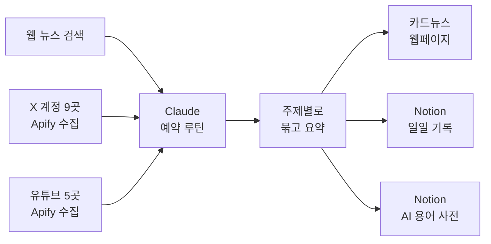

# LLM 기반 개인 맞춤 뉴스 브리핑 자동화
#### (개인 프로젝트)

> Claude 예약 루틴으로 매일 아침 뉴스·X·유튜브를 모아 
> 주제별 카드뉴스 페이지와 Notion 기록으로 정리하는 개인 브리핑 시스템입니다.

## 프로젝트 개요

- **목표**: 매일 흩어진 경제·테크 소식을 같은 기준으로 모아, 
  짧은 시간에 시장 흐름을 파악할 수 있는 브리핑 만들기
- **내용**: 2026년 10월부터 매일 오전 9시 47분(한국 시간)에 자동 실행되는 뉴스 브리핑
- **방법**: Claude 예약 루틴 + 웹 검색 + Apify(X·유튜브 수집) + Notion 연동
- **결과**: 매일 카드뉴스 웹페이지, Notion 일일 기록, AI 용어 사전이 자동으로 갱신됨

## 프로젝트 목표

경제·시장 뉴스는 뉴스 사이트, X, 유튜브에 흩어져 있고, 
같은 사건이 여러 곳에서 다른 숫자와 표현으로 나옵니다. 
매일 직접 찾아 읽으면 시간이 많이 들고, 날마다 보는 기준도 달라집니다.

그래서 수집 대상과 정리 규칙을 한 번 설계해 두고, 
매일 같은 형식의 브리핑을 자동으로 받아 보는 것을 목표로 했습니다.

## 시스템 구조

## 수행 내용

**① 수집 대상 설계**

| 입력 | 대상 | 기준 |
|---|---|---|
| 웹 뉴스 | 검색으로 찾은 기사 원문 | 출처 기사를 직접 열어 사실 확인 |
| X | OpenAI, Anthropic, Google DeepMind, Reuters, Bloomberg, WSJ Markets 등 9개 계정 | 최근 약 36시간의 원글만 사용 (답글·리트윗·광고 제외) |
| 유튜브 | 미국 증시·AI 채널 5곳 | 최근 약 48시간의 긴 영상 |

**② 출처가 아니라 주제로 묶기**

같은 사건이 뉴스와 X, 영상에 함께 나오면 하나의 카드로 합치고 출처 링크만 늘립니다. 
그래서 "X에서 본 소식"처럼 출처별 묶음이 생기지 않습니다.

| 섹션 | 분량 | 내용 |
|---|---|---|
| AI·테크 | 6~9장 | 새 AI 모델·서비스, 반도체, 빅테크, 그날 가장 화제인 테크 뉴스 |
| 경제·시장 | 5~6장 | 코스피·코스닥, 원·달러, 미국 증시, 연준 전망, 유가·원자재 |
| 세계 경제 | 2장 | IMF·OECD 전망, 중국·일본·유럽, 해외 중앙은행 |
| 국내·북한 | 3~4장 | 짧은 헤드라인 |

**③ 카드 작성 규칙**

- 카드마다 핵심 숫자 하나를 크게 보여 주고, 
  그 숫자가 언제 기준인지 함께 적습니다.
- 본문은 4문장 안팎으로, 무슨 일인지 → 배경 → 한국에 어떤 의미인지 순서로 씁니다.
- 출처에 있는 내용만 쓰고, 출처끼리 숫자가 다르면 종가를 우선합니다. 
  확인이 안 되는 내용은 카드를 빼는 쪽을 택합니다.

**④ 결과물과 기록**

| 결과물 | 내용 |
|---|---|
| 카드뉴스 웹페이지 | 주제별로 옆으로 넘기는 카드, 날짜별 지난 브리핑, 브리핑 내용으로 질문하는 입력창 |
| Notion 일일 페이지 | 30초 요약, "오늘의 숫자" 표(코스피·코스닥·원·달러·나스닥·S&P 500·WTI), 주제별 카드 |
| Notion AI 용어 사전 | 브리핑에 나온 AI 모델·서비스를 자동으로 추가하고, 이미 있는 항목에는 관련 브리핑을 연결 |

## 결과

2026년 10월 3일부터 매일 아침 자동으로 실행되고 있습니다. 
하루 브리핑은 약 20장의 카드로, 숫자마다 기준 날짜와 출처 링크가 붙어 있어 
그날의 시장 흐름과 근거를 함께 확인할 수 있습니다.

### [실제 브리핑 예시 보기 (2026년 10월 17일)](https://mjk022.github.io/portfolio/brief/)

실제로 생성된 하루치 카드뉴스 페이지를, 개인 정보와 질문창을 빼고 그대로 옮긴 것입니다. 
카드 본문은 Claude가 기사를 읽고 직접 요약한 문장이며, 원문 기사는 출처 링크로만 연결됩니다.

## 사용 도구

| 도구 | 역할 |
|---|---|
| Claude (예약 루틴) | 매일 정해진 시간에 실행, 수집·요약·정리 전체 수행 |
| Apify | X 게시물과 유튜브 영상 목록 수집 |
| Notion | 일일 기록과 AI 용어 사전 데이터베이스 |

## 파일 구성

| 파일 | 설명 |
|---|---|
| `prompt.md` | 예약 루틴에 등록한 지시문 전문 (아티팩트 주소, Notion ID는 자리표시자로 바꿈) |
