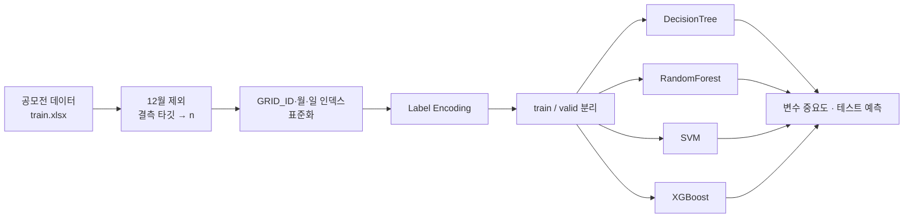

# 🚒 강원 소방안전 공모전 — 사고 유형 예측 (2022)

| 항목 | 내용 |
|---|---|
| 대회 | 2022 강원 소방안전 빅데이터 공모전 (팀) |
| 담당 | 모델 실험 (DecisionTree · RandomForest · SVM · XGBoost 비교) |
| 문제 | 격자(GRID_ID) × 날짜별로 어떤 유형의 소방 출동 사고가 날지 분류 |
| 타깃 | 사고 유형 26종 + 사고 없음(`n`) |
| 도구 | Python, pandas, scikit-learn, XGBoost, Google Colab |

## 분석 흐름

## 입력 변수

| 변수 | 의미 |
|---|---|
| `month`, `day`, `hol` | 월, 일, 공휴일 여부 |
| `pop` | 유동인구 |
| `평균 풍속(m/s)` | 기상 |
| `b_point`, `a_point`, `n_point` | 격자 내 시설 수 |

## 결과

| 노트북 | 모델 | 검증 정확도 |
|---|---|---|
| `DecisionTree.ipynb` | DecisionTreeClassifier | 0.9650 |
| `RandomForest.ipynb` | RandomForestClassifier | 0.9828 |
| `SVM.ipynb` | SVC | 0.9832 |
| `XGBoost.ipynb` | XGBClassifier (n_estimators=200, max_depth=7) | 0.9832 |
| (기준) | 전부 "사고 없음"으로 예측 | **0.9832** |

## 회고

| 문제 | 원인 | 다시 한다면 |
|---|---|---|
| 정확도가 높아도 의미가 약함 | 검증 데이터의 98.3%가 "사고 없음" | 클래스별 recall, macro F1로 평가 |
| 불균형 보정이 안 됨 | XGBoost에 `sample_weight`를 생성자로 넘겨 무시됨 | `fit(..., sample_weight=w)` 또는 리샘플링 |
| 27개 클래스를 한 번에 분류 | 희소 클래스가 많음 | 사고 발생 여부 → 유형 분류 2단계 구조 |

원본 데이터(`train.xlsx`, `test.xlsx`)는 공모전 제공 데이터라 포함하지 않았습니다.
