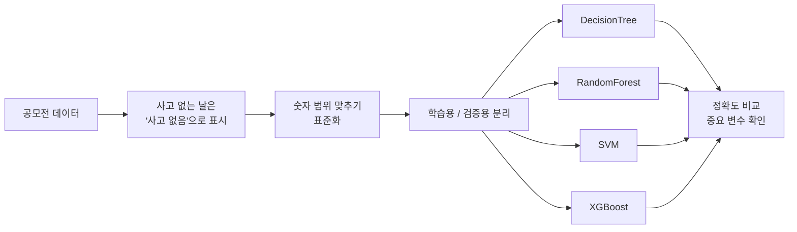

# 구급출동 사고 유형 예측
#### (2022 소방안전 AI예측 경진대회)

> 강원도 소방본부가 주관한 2022년 제2회 소방안전 AI예측 경진대회에서, 
> 원주시를 1km 격자로 나눈 데이터로 "그날 그 격자에서 어떤 유형의 구급출동이 일어날지"를 
> 예측하는 머신러닝 모델 4종을 비교한 프로젝트입니다.

## 프로젝트 개요

- **목표**: 격자·날짜별 구급출동 사고 유형을 예측해 구급 수요에 맞춘 사전 배치에 활용
- **내용**: 매월 마지막 날 구급출동이 발생한 격자의 사고 유형 예측 (대회 과제)
- **방법**: 데이터 전처리 후 
  DecisionTree, RandomForest, SVM, XGBoost 학습·비교
- **결과**: 검증 정확도 0.96~0.98, 
  데이터 불균형으로 인한 성능 과대평가 문제를 분석하고 개선 방향 제시
- **담당**: 모델 실험 (4개 모델 학습·비교)

## 프로젝트 목표

구급출동은 낙상, 교통사고, 질병, 동물 관련 사고 등 종류가 다양합니다. 
어느 지역에서 어떤 사고가 자주 나는지 미리 예측할 수 있다면, 
사고가 나기 전에 구급 인력과 장비를 알맞게 배치할 수 있습니다.

| 항목 | 대회 내용 |
|---|---|
| 대회 | 2022년 제2회 소방안전 AI예측 경진대회 (주관: 강원도 소방본부, 2022.10~11) |
| 과제 | 매월 마지막 날, 구급출동이 발생한 격자의 사고 유형 예측 |
| 데이터 | 강원도 원주시 1km 격자 단위 구급출동·인구·소방지수 데이터 (2021.01~12) |
| 평가 | 예측 정확도 80% (구급출동이 발생한 격자를 맞히면 점수 획득) + 코드 완성도·해설 20% |

## 데이터

원주시를 1km 격자(GRID_ID)로 나누고, 격자마다 하루 단위로 다음 정보가 기록된 데이터입니다.

| 변수 | 의미 |
|---|---|
| `month`, `day`, `hol` | 월, 일, 공휴일 여부 |
| `pop` | 유동인구 |
| `평균 풍속(m/s)` | 날씨 |
| `b_point`, `a_point`, `n_point` | 격자 안의 시설 수 |
| `cat` (예측 대상) | 그날 발생한 사고 유형 26종 (예: 낙상, 교통사고) 또는 사고 없음 |

## 수행 내용

**① 전처리**

원본 데이터에서 사고가 없었던 날은 정답 칸이 비어 있어서, 
이를 "사고 없음"이라는 하나의 유형으로 채웠습니다. 
유동인구와 풍속처럼 단위가 다른 숫자들은 같은 기준으로 비교할 수 있게 표준화했습니다.

**② 모델 4종 비교**

같은 데이터로 성격이 다른 네 가지 모델을 학습했습니다.

| 모델 | 간단한 설명 |
|---|---|
| DecisionTree | 질문을 반복해 데이터를 나누는 하나의 나무 |
| RandomForest | 여러 개의 나무를 만들어 다수결로 결정 |
| SVM | 데이터를 가장 잘 나누는 경계선을 찾음 |
| XGBoost | 앞 나무가 틀린 부분을 다음 나무가 보완하며 학습 |

**③ 결과 분석**

각 모델이 어떤 변수를 중요하게 봤는지 시각화하고, 
테스트 데이터에 대한 예측 결과를 저장했습니다.

## 결과

| 노트북 | 모델 | 검증 정확도 |
|---|---|---|
| `DecisionTree.ipynb` | DecisionTree | 0.9650 |
| `RandomForest.ipynb` | RandomForest | 0.9828 |
| `SVM.ipynb` | SVM | 0.9832 |
| `XGBoost.ipynb` | XGBoost | 0.9832 |
| 비교 기준 | 무조건 "사고 없음"이라고 답하기 | **0.9832** |

정확도만 보면 네 모델 모두 매우 높습니다. 
하지만 표의 마지막 줄이 중요합니다. 
검증 데이터의 약 98.3%가 "사고 없음"이어서, 
**아무것도 학습하지 않고 무조건 "사고 없음"이라고만 답해도 정확도가 0.9832**가 나옵니다. 
SVM과 XGBoost의 정확도가 이 값과 똑같다는 것은, 
실제 사고를 거의 맞히지 못했을 가능성이 높다는 뜻입니다.

대회 평가는 구급출동이 발생한 격자의 사고 유형을 맞혀야 점수를 얻는 방식이므로, 
"사고 없음"을 잘 맞히는 것만으로는 대회 점수에 도움이 되지 않습니다.

## 한계 및 개선 방향

가장 큰 한계는 **데이터 불균형**입니다. 
정확도는 다수 클래스에 크게 좌우되므로, 
이 문제에서는 사고 유형별 성능을 볼 수 있는 지표와 불균형 보정이 필요합니다.

| 문제 | 원인 | 개선 방법 |
|---|---|---|
| 정확도가 높아도 의미가 약함 | 데이터의 98.3%가 "사고 없음" | 사고 유형별로 얼마나 맞혔는지 보는 recall, macro F1로 평가 |
| 불균형 보정이 적용되지 않음 | XGBoost에 가중치(`sample_weight`)를 잘못된 위치에 넣어 무시됨 | `fit()` 단계에서 가중치를 넣거나, 사고 데이터를 늘리는 리샘플링 |
| 27개 유형을 한 번에 분류 | 데이터가 거의 없는 유형이 많음 | "사고가 나는가"를 먼저 예측한 뒤 "어떤 사고인가"를 분류하는 2단계 구조 |

## 파일 구성

| 파일 | 설명 |
|---|---|
| `DecisionTree.ipynb` | 의사결정나무 모델, 변수 중요도, 테스트 예측 |
| `RandomForest.ipynb` | 랜덤 포레스트 모델 |
| `SVM.ipynb` | 서포트 벡터 머신 모델 |
| `XGBoost.ipynb` | XGBoost 모델 |

원본 데이터는 공모전 제공 데이터라 포함하지 않았습니다.
