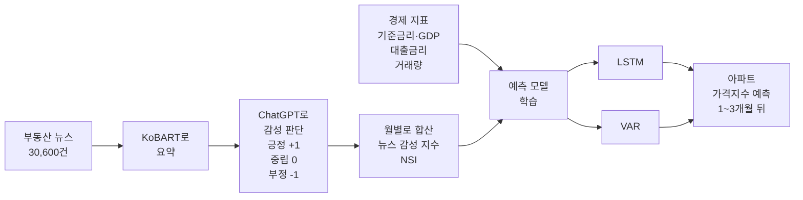
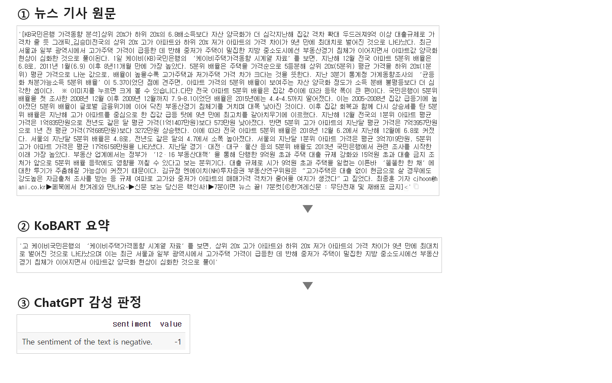
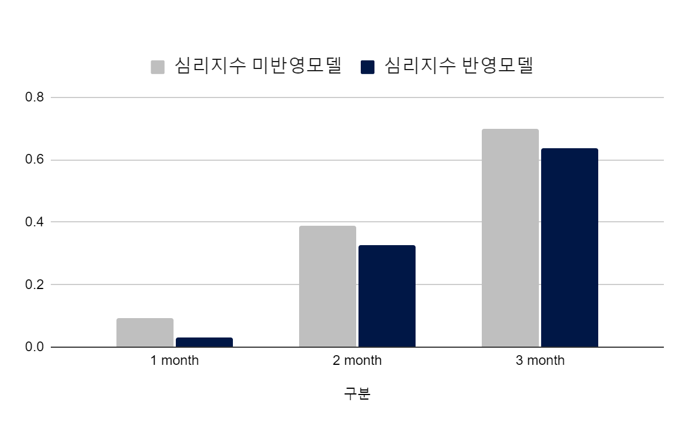
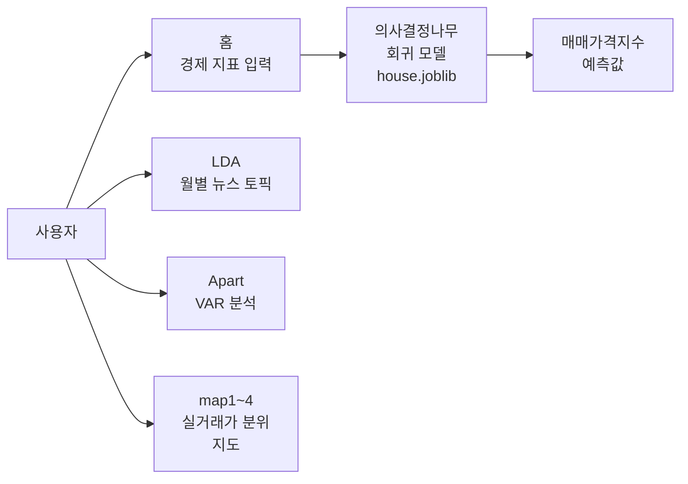

# 뉴스 감성으로 아파트 가격 예측하기
#### (정보처리학회논문지 게재 논문)

> 뉴스 기사의 분위기(긍정/부정)를 생성 AI로 점수화해,<br>
> 아파트 매매가격 예측의 정확도를 높인 연구입니다.<br>
> 정보처리학회논문지에 게재되었습니다.

## 프로젝트 개요

- **목표**: 경제 지표에 드러나지 않는 시장 심리를 뉴스로 수치화해<br>
  아파트 가격 예측 정확도 향상
- **내용**: 뉴스 감성 지수를 만들어 아파트 매매가격지수 예측 모델에 추가
- **방법**: KoBART로 기사 요약 → ChatGPT로 감성 판단 → LSTM·VAR 모델로 예측
- **결과**: 감성 지수를 넣은 LSTM의 1개월 예측 오차가 0.60 → 0.40으로 감소,<br>
  예측 결과를 확인할 수 있는 웹사이트 구현
- **논문**: 「생성 AI기반 뉴스 감성 분석과 부동산 가격 예측: LSTM과 VAR모델의 적용」,<br>
  정보처리학회논문지 13권 5호, 2024 · [KCI 논문 보기](https://www.kci.go.kr/kciportal/ci/sereArticleSearch/ciSereArtiView.kci?sereArticleSearchBean.artiId=ART003084610) · [DOI](https://doi.org/10.3745/TKIPS.2024.13.5.209)

## 프로젝트 목표

아파트 가격을 예측할 때는 보통 금리, GDP, 거래량 같은 경제 지표를 사용합니다.<br>
그런데 실제 부동산 시장은<br>
"지금 사야 오른다", "곧 떨어진다" 같은 사람들의 기대 심리에 크게 움직입니다.<br>
이런 심리는 숫자로 된 경제 지표에는 잘 나타나지 않습니다.

뉴스 기사는 이런 시장 분위기를 빠르게 보여줍니다.<br>
그래서 **뉴스 기사가 긍정적인지 부정적인지를 숫자로 만들어 예측 모델에 넣으면,<br>
가격 예측이 더 정확해지지 않을까?**<br>
라는 질문에서 연구를 시작했습니다.

기존 연구들은 미리 만든 "감성 사전"(긍정 단어 목록, 부정 단어 목록)으로 기사를 분류했습니다.<br>
하지만 부동산 기사는 "규제 완화"처럼<br>
사전만으로는 좋고 나쁨을 판단하기 어려운 표현이 많습니다.<br>
그래서 이 연구에서는<br>
문맥을 이해할 수 있는 **생성 AI(ChatGPT)에게 직접 기사를 판단하게** 했습니다.

## 수행 내용



**① 뉴스 수집과 요약**

2019년부터 51개월 동안 매달 약 600건씩,<br>
총 30,600건의 부동산 뉴스를 네이버에서 수집했습니다.<br>
기사 전문을 그대로 넣으면 길고 비용이 많이 들어서,<br>
한국어 요약 모델인 KoBART로 먼저 핵심만 요약했습니다.

**② 감성 판단과 지수 만들기**

요약문을 ChatGPT에 넣어 긍정(+1), 중립(0), 부정(-1)으로 분류했습니다.<br>
AI가 판단하지 못했거나 중립으로 분류한 기사는 사람이 다시 확인했습니다.<br>
한 달 동안의 점수를 모두 더한 값을<br>
**뉴스 감성 지수(NSI, News Sentiment Index)** 라고 정의했습니다.<br>
값이 클수록 그 달의 부동산 뉴스가 긍정적이었다는 뜻입니다.

아래는 실제 기사 한 건이 처리되는 과정입니다.



**③ 가격 예측 모델 비교**

두 종류의 시계열 예측 모델을 사용했습니다.

| 모델 | 간단한 설명 |
|---|---|
| Multi-head attention LSTM | 과거 흐름을 기억하는 딥러닝 모델(LSTM)에,<br>중요한 시점에 더 집중하는 어텐션을 결합 |
| VAR (벡터자기회귀) | 여러 변수가 서로 영향을 주고받는 관계를<br>통계적으로 모델링하는 전통적인 방법 |

각 모델을 **감성 지수를 넣은 버전**과 **넣지 않은 버전**으로 나누어,<br>
2019.01–2022.12 데이터로 학습하고 2023년 1–3월을 예측했습니다.

| 사용 데이터 | 출처 |
|---|---|
| 전국 아파트 매매가격지수 (예측 대상) | KB 부동산 데이터 허브 |
| 기준금리, 명목 GDP, 대출금리, 아파트 매매거래량 | 한국은행, 한국부동산원 |
| 뉴스 감성 지수 | 네이버 뉴스 수집 후 직접 산출 |

## 결과

예측이 실제 값과 얼마나 차이 나는지를 RMSE(평균 오차, **낮을수록 정확**)로 비교했습니다.

| 모델 | 1개월 뒤 | 2개월 뒤 | 3개월 뒤 |
|---|---|---|---|
| LSTM (감성 지수 없음) | 0.60 | 0.872 | 1.117 |
| **LSTM (감성 지수 추가)** | **0.40** | **0.724** | **1.03** |
| VAR (감성 지수 없음) | 1.6484 | 0.6254 | 0.9220 |
| **VAR (감성 지수 추가)** | **1.1315** | **0.3413** | 1.6227 |

- LSTM은 1·2·3개월 모든 예측에서 감성 지수를 넣었을 때 오차가 줄었습니다.
- VAR는 1·2개월 단기 예측에서 오차가 줄었고, 3개월 예측에서는 오히려 늘었습니다.
- 뉴스 같은 텍스트 데이터가 부동산 가격 예측에 실제로 도움이 된다는 것을 확인했습니다.
- 부동산처럼 전용 감성 사전이 없는 분야에서도<br>
  ChatGPT로 빠르고 저렴하게 라벨링할 수 있음을 보였습니다.

**학술대회 발표 결과 (ACK 2023)**

학술지 게재 전 학술대회(ACK 2023)에서 발표한 결과입니다.<br>
모델 설정(어텐션 헤드 16개)과 평가 조건이 학술지 버전과 달라 수치는 다르지만,<br>
이때도 감성 지수를 넣은 모델이 1·2·3개월 모두 오차가 낮았습니다.

| 구분 | 1개월 | 2개월 | 3개월 |
|---|---|---|---|
| 감성 지수 미반영 | 0.0934 | 0.390 | 0.70 |
| **감성 지수 반영** | **0.03** | **0.326** | **0.636** |



## 한계 및 개선 방향

- ChatGPT가 감성을 정확히 판단했는지 객관적으로 검증하기 어렵습니다.<br>
  전문가가 직접 판단한 예시를 프롬프트에 넣으면 개선될 수 있습니다.
- 학습 기간이 48개월로 짧아 데이터가 적습니다.
- 뉴스 외에 부동산 카페 같은 SNS 여론을 추가 변수로 반영할 수 있습니다.

## 웹 서비스

**바로 보기: https://mjk022.github.io/portfolio/**

연구 결과를 누구나 확인할 수 있도록 Django로 웹사이트를 만들었습니다.<br>
경제 지표를 입력해 매매가격지수를 바로 예측해 보고,<br>
뉴스 토픽 분석과 지역별 실거래가 지도를 함께 볼 수 있습니다.

| 페이지 | 내용 |
|---|---|
| 홈 (예측) | 금리, 국내총생산, 대출금리, 매매 거래량을 입력하면<br>학습된 의사결정나무 회귀 모델이 아파트 매매가격지수를 예측 |
| LDA | 2021~2022년 월별 부동산 뉴스의 주요 토픽을<br>LDA로 분석한 시각화 24개 |
| Apart | 경제 지표 기반 VAR 모델 분석 과정과 결과 |
| map1~map4 | 아파트 실거래가를 가격 분위(1~4분위)별로 나눠 표시한 지도 |
| 로그인 / 회원가입 | 사용자 계정 기능 |



**로컬에서 Django로 실행하기**

```bash
cd web
pip install -r requirements.txt
python manage.py migrate
python manage.py runserver
```

브라우저에서 `http://127.0.0.1:8000`으로 접속합니다.<br>
공개 사이트(`docs/`)는 같은 페이지를 정적 HTML로 옮긴 버전으로,<br>
예측 모델의 규칙을 JavaScript로 옮겨 브라우저에서 바로 계산합니다(로그인·회원가입 제외).

## 파일 구성

| 파일 | 설명 |
|---|---|
| `아파트 매매가격지수 예측.ipynb` | Multi-head attention LSTM 모델, 감성 지수 포함/제외 비교 |
| `web/` | 예측 결과와 분석 자료를 보여주는 Django 웹사이트 |

데이터 파일은 포함하지 않았습니다.<br>
노트북은 Google Colab에서 Google Drive의 엑셀 파일을 불러와 실행하는 구조입니다.
