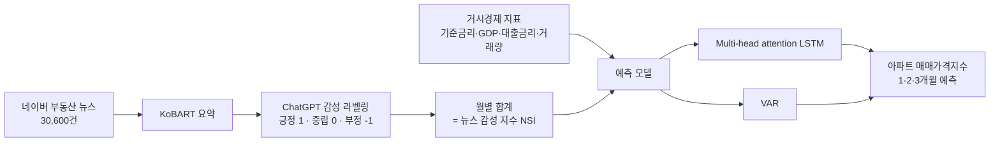

# 🏢 생성 AI 기반 뉴스 감성 분석과 부동산 가격 예측

| 항목 | 내용 |
|---|---|
| 논문 | 「생성 AI기반 뉴스 감성 분석과 부동산 가격 예측: LSTM과 VAR모델의 적용」 |
| 저자 | 김수아, 권미주, 김현희 |
| 게재 | 정보처리학회논문지 (한국정보처리학회), 2024 · ACK 2023 발표 논문 확장 |
| 링크 | [논문 정보 (DCollection)](https://dcollection.sogang.ac.kr/dcollection/srch/srchDetail/000000081272) |
| 도구 | Python, BeautifulSoup, KoBART, OpenAI API, TensorFlow/Keras, statsmodels |

## 연구 흐름

## 데이터

| 구분 | 내용 | 출처 |
|---|---|---|
| 종속변수 | 전국 아파트 매매가격지수 (월별) | KB 부동산 데이터 허브 |
| 독립변수 | 기준금리, 명목 GDP, 대출금리, 아파트 매매거래량 | 한국은행, 한국부동산원 |
| 신규 변수 | 뉴스 감성 지수 (NSI) | 네이버 뉴스 크롤링 → 직접 산출 |
| 기간 | 학습 2019.01–2022.12 / 테스트 2023.01–03 | |

## 결과 (RMSE, 낮을수록 좋음)

| 모델 | 1개월 | 2개월 | 3개월 |
|---|---|---|---|
| LSTM (NSI 제외) | 0.60 | 0.872 | 1.117 |
| **LSTM (NSI 포함)** | **0.40** | **0.724** | **1.03** |
| VAR (NSI 제외) | 1.6484 | 0.6254 | 0.9220 |
| **VAR (NSI 포함)** | **1.1315** | **0.3413** | 1.6227 |

NSI를 넣으면 LSTM은 모든 기간, VAR는 1·2개월 단기 예측에서 오차가 줄었습니다.

## 파일

| 파일 | 설명 |
|---|---|
| `아파트 매매가격지수 예측.ipynb` | Multi-head attention LSTM, NSI 포함·제외 비교 |

데이터 파일은 포함하지 않았습니다 (Colab에서 Google Drive 마운트 후 실행).
