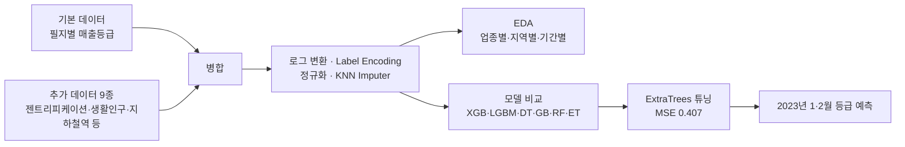

# 🏪 2023 빅콘테스트 — 소상공인 매출등급 예측

| 항목 | 내용 |
|---|---|
| 대회 | 제11회 2023 빅콘테스트 · 빅데이터플랫폼 활용 분야 · 지정주제(부동산) |
| 팀 | 3인 팀 |
| 문제 | 서울시 필지 단위 요식업 소상공인의 2023년 1·2월 매출등급(1~5) 예측 |
| 담당 (이 폴더) | 기간별 · 업종별 EDA |
| 도구 | pandas, seaborn, folium, scikit-learn, LightGBM, XGBoost |

## 전체 분석 흐름

## 사용 데이터

| 데이터 | 변수 | 출처 |
|---|---|---|
| 필지 단위 소상공인 매출등급 | 업종, 매출등급 | 대회 제공 |
| 필지 기초데이터 | 대지면적, 위경도 | 부동산 빅데이터 플랫폼 |
| 젠트리피케이션 위험지수 | GTFC_SCOR | 부동산 빅데이터 플랫폼 |
| 배후지 인구당 상가면적 | PUL_PARTY_SOPSRT_DIMS | 부동산 빅데이터 플랫폼 |
| 부동산 거래량 · SNS 노출 대비 유동인구 | fpop_scor_property, FPOP_SCOR | 부동산 빅데이터 플랫폼 |
| 지하철역 위치 | 반경 800m 내 역 개수 | 서울 열린데이터광장 |
| 상권변화지표 · 생활인구 | 상권_변화_지표, 총생활인구수 | 서울 열린데이터광장 |

## 모델 비교 (MSE, 낮을수록 좋음)

| 모델 | MSE |
|---|---|
| GradientBoosting | 1.18 |
| LightGBM | 1.11 |
| XGBoost | 1.06 |
| DecisionTree | 0.81 |
| RandomForest | 0.45 |
| ExtraTrees (기본) | 0.434 |
| **ExtraTrees (튜닝)** | **0.407** |

최종 파라미터: `n_estimators=300, min_samples_split=8, max_depth=50`

## 기간별 EDA (`기간별EDA.ipynb`)

| 분석 | 방법 | 발견 |
|---|---|---|
| 월별 매출등급 분포 | 월 × 등급 집계, stacked bar | 모든 달에서 3등급 중심 분포, 월별 변화 작음 |
| 가게별 평균 등급 | (필지번호, 업종) 키로 등급 합 ÷ 영업 개월 수 | |
| 우수 가게 (평균 ≤ 2) | 업종별 비율로 정규화 | 패스트푸드 비율 최고, 주점 최저 |
| 위기 가게 (평균 ≥ 4) | 업종별 비율로 정규화 | 기타 외국식 최다, 아이스크림/빙수 최소 |
| 영업 11개월 이하 가게 | 업종 × 반올림 등급 비율 | 아이스크림/빙수가 1등급·5등급 모두 많음 (계절성) |

## 결과 활용 제안

| 관점 | 활용 |
|---|---|
| 기간별 | 2022년 12월 대비 예상 등급이 크게 떨어지는 가게를 미리 지원 |
| 지역별 | 도봉·강북·성북·동대문·중랑·은평구는 꾸준히 낮고, 강남·서초구는 높음 → 지역 대시보드 |
| 정책 | 저등급 매장 디지털 마케팅 교육, 상권 브랜딩, 젠트리피케이션 지역 상생 협약 |
