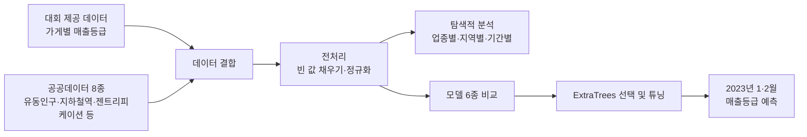

# 서울 음식점 매출등급 예측
#### (2023 빅콘테스트)

> 서울시 음식점들의 매출등급(1~5등급)과 주변 환경 데이터를 분석해, 
> 2023년 1·2월의 매출등급을 예측하고 
> 폐업 위험이 큰 가게를 찾아낸 공모전 프로젝트입니다.

## 프로젝트 개요

- **목표**: 음식점의 미래 매출등급을 예측해 폐업 위험이 큰 가게와 지역을 사전에 파악
- **내용**: 서울시 필지(땅) 단위 음식점의 미래 매출등급 예측
- **방법**: 공공데이터 8종을 추가로 결합 → 탐색적 분석 → 머신러닝 모델 6종 비교
- **결과**: ExtraTrees 모델로 예측 오차(MSE) 0.407 달성, 
  업종·지역별 위험 패턴 발견
- **담당**: 기간별·업종별 탐색적 분석(EDA)

## 프로젝트 목표

코로나 이후에도 고물가·고금리가 이어지면서 상가 공실률이 계속 오르고 있습니다. 
특히 음식점은 창업이 쉬운 만큼 폐업도 많아서, 
2019년 기준 폐업률이 21.5%로 전체 산업 평균(11.5%)의 두 배 가까이 됩니다.

가게의 매출등급을 미리 예측할 수 있다면, 매출이 떨어질 것으로 예상되는 가게를 먼저 지원하거나, 
창업하려는 사람이 입지를 고를 때 참고 자료로 쓸 수 있습니다.

## 수행 내용

**① 주변 환경 데이터 추가**

대회에서 준 데이터는 "어느 땅의 어떤 업종 가게가 몇 등급인지"뿐이었습니다. 
하지만 매출은 가게 주변에 사람이 얼마나 다니는지, 지하철역이 가까운지 등에 크게 좌우됩니다. 
그래서 매출에 영향을 주는 요인을 **가게 위치 정보**와 **유동인구 정보**로 나누고, 
각각에 해당하는 공공데이터 8종을 추가로 모았습니다.

| 구분 | 데이터 | 사용한 변수 | 주기 | 출처 |
|---|---|---|---|---|
| 대회 제공 | 필지단위 소상공인 매출등급 정보 | 법정동, 업종 코드, 매출등급 | 월별 | 2023 빅콘테스트 |
| 위치 정보 | 필지기초데이터 | 대지면적, 위도·경도 | 고정 | 부동산 빅데이터 플랫폼 |
| 위치 정보 | 서울시 역사마스터 정보 | 가게 반경 800m 안의 지하철역 수 | 고정 | 서울 열린데이터광장 |
| 위치 정보 | 배후지 인구당 상가면적 | 주변 인구 1명당 상가 면적 | 분기별 | 부동산 빅데이터 플랫폼 |
| 위치 정보 | 젠트리피케이션 위험지수 | 임대료 상승으로 기존 상인이 밀려날 위험 | 월별 | 부동산 빅데이터 플랫폼 |
| 유동인구 | SNS 노출 대비 유동인구 | SNS 언급량에 비해 실제로 오가는 사람 수 | 월별 | 부동산 빅데이터 플랫폼 |
| 유동인구 | 부동산 거래량(금액) 대비 유동인구 | 부동산 거래 규모에 비해 오가는 사람 수 | 분기별 | 부동산 빅데이터 플랫폼 |
| 유동인구 | 행정동 단위 생활인구(내국인) | 해당 지역에 머무는 총 인구 | 월별 | 서울 열린데이터광장 |
| 유동인구 | 행정동별 상권변화지표 | 상권이 성장·정체·쇠퇴 중인지 4단계 | 분기별 | 서울 열린데이터광장 |
| 보조 | 행정동–법정동 매칭표, 자치구 경계 GeoJSON | 행정동 데이터를 법정동에 연결, 지도 시각화 | — | 행정안전부, southkorea/seoul-maps |

**② 전처리**

데이터마다 주기와 지역 단위가 달라서, 모두 **법정동 × 월** 기준으로 맞췄습니다.

- 월별 데이터는 월마다 나뉜 파일을 하나로 합쳤습니다.
- 분기별 데이터는 해당 분기의 세 달에 같은 값을 채워 월별로 바꿨습니다.
- 행정동 단위 데이터는 매칭표로 법정동에 연결했습니다.
- 필지기초데이터의 좌표계를 위도·경도로 바꾸고, 이를 이용해 가게 반경 800m 안의 지하철역 수를 새 변수로 만들었습니다.

이후 면적처럼 값의 차이가 지나치게 큰 변수는 로그 변환으로 분포를 고르게 만들고, 
업종 코드 같은 문자 변수는 숫자로 바꿨습니다(라벨 인코딩). 
위치 정보가 빠진 가게는 필지 번호를 주소로 바꾼 뒤 지도 API로 좌표를 직접 찾았고, 
나머지 빈 값은 비슷한 이웃 데이터의 값으로 채웠습니다(KNN Imputer). 
빈 값 채우기는 SVM, DNN 방식도 시도했지만 시간 효율이 가장 좋은 KNN을 선택했습니다.

**③ 탐색적 분석: 기간별·업종별 (담당, `기간별EDA.ipynb`)**

먼저 월별로 등급 분포를 봤지만 달마다 거의 차이가 없었습니다. 
그래서 시간보다는 **가게 단위**로 보는 것이 의미 있다고 판단했습니다. 
같은 땅의 같은 업종을 하나의 가게로 보고, 영업한 달들의 평균 등급을 구해 
"우수 가게(평균 2등급 이내)"와 "위기 가게(평균 4등급 이상)"를 나눴습니다. 
업종마다 가게 수가 크게 달라서 개수 대신 업종별 비율로 비교했습니다.

**④ 모델 비교 (팀)**

2022년 1~10월을 학습용, 11~12월을 검증용으로 나누고 
머신러닝 모델 6종을 같은 데이터로 학습해, 
실제 등급과 예측 등급의 차이(MSE, 낮을수록 좋음)를 비교했습니다.

## 결과

**탐색적 분석에서 발견한 것**

| 분석 | 발견 | 해석 |
|---|---|---|
| 우수 가게 | 패스트푸드 비율이 가장 높고, 주점이 가장 낮음 | 패스트푸드는 운영 매뉴얼이 통일되어 품질이 고름 |
| 위기 가게 | 기타 외국식이 가장 많음 | 가게마다 콘셉트와 맛 차이가 커서 성패가 갈림 |
| 1년 미만 가게 | 아이스크림/빙수가 1등급과 5등급 모두 많음 | 계절을 크게 타서 매출이 안정적이지 않음 |
| 지역별 (팀) | 강남·서초구는 꾸준히 높고, 도봉·강북·성북·동대문·중랑·은평구는 낮음 | 지역 맞춤 지원이 필요 |
| 동 단위 (팀) | 강남구 안에서도 지하철역이 없는 개포·율현·세곡동은 상대적으로 낮고, 동대문·중랑구는 대지면적이 작은 편 | 접근성과 가게 규모가 등급에 영향 |

**모델 비교**

| 모델 | 예측 오차 (MSE) |
|---|---|
| GradientBoosting | 1.18 |
| LightGBM | 1.11 |
| XGBoost | 1.06 |
| DecisionTree | 0.81 |
| RandomForest | 0.45 |
| ExtraTrees (기본 설정) | 0.434 |
| **ExtraTrees (최적화)** | **0.407** |

가장 오차가 작은 ExtraTrees를 최종 모델로 선택해 2023년 1·2월 매출등급을 예측했습니다. 
이 결과를 바탕으로 등급이 크게 떨어질 것으로 예상되는 가게를 미리 지원하는 방안, 
지역별 상권 대시보드, 저등급 매장을 위한 SNS 마케팅 교육 등을 제안했습니다.

**지도 바로 보기** (클릭하면 브라우저에서 확대·축소할 수 있습니다)

| 지도 | 내용 |
|---|---|
| [구별 평균 매출등급](https://mjk022.github.io/portfolio/bigcontest/gu_avg_grade.html) | 2022년 자치구별 평균 등급 (붉을수록 취약) |
| [2022년 1월 실제](https://mjk022.github.io/portfolio/bigcontest/gu_2022_01_actual.html) · [2023년 1월 예측](https://mjk022.github.io/portfolio/bigcontest/gu_2023_01_pred.html) | 같은 달의 실제 등급과 모델 예측 등급 비교 |
| [2022년 2월 실제](https://mjk022.github.io/portfolio/bigcontest/gu_2022_02_actual.html) · [2023년 2월 예측](https://mjk022.github.io/portfolio/bigcontest/gu_2023_02_pred.html) | 같은 달의 실제 등급과 모델 예측 등급 비교 |
| [강남구](https://mjk022.github.io/portfolio/bigcontest/dong_gangnam.html) · [서초구](https://mjk022.github.io/portfolio/bigcontest/dong_seocho.html) · [동대문구](https://mjk022.github.io/portfolio/bigcontest/dong_dongdaemun.html) · [중랑구](https://mjk022.github.io/portfolio/bigcontest/dong_jungnang.html) | 동 단위 평균 등급과 가게 위치 (각 약 14MB, 로딩에 시간이 걸림) |

## 파일 구성

| 파일 | 설명 |
|---|---|
| `빅콘테스트_최종.ipynb` | 팀 최종 코드: 데이터 수집·전처리 → 탐색적 분석 → 모델 6종 비교 → 예측 결과 활용 |
| `기간별EDA.ipynb` | 담당 부분: 월별 등급 분포, 가게별 평균 등급, 우수·위기 가게의 업종별 비율 분석 |

최종 노트북의 구성은 다음과 같습니다.

| 순서 | 내용 |
|---|---|
| 1. 원본 제공 데이터 | 필지단위 소상공인 매출등급 정보 불러오기 |
| 2. 추가 수집 데이터 | 공공데이터 8종을 법정동 × 월 기준으로 가공 |
| 3. 데이터 탐색 | 상관관계, 변수 분포, 지역별·업종별·기간별 분석 |
| 4~5. 전처리 | 학습용(2022년)과 예측용(2023년 1·2월) 데이터 전처리 |
| 6. 모델 | XGBoost, LightGBM, DecisionTree, GradientBoosting, RandomForest, ExtraTrees 비교 |
| 활용방안 | 기간별·업종별·지역별 예측 결과 분석 |

노트북 안의 지도 출력은 GitHub에서 표시되지 않아 빼고, 위의 링크로 옮겼습니다.

데이터는 대회 제공 데이터라 포함하지 않았습니다.