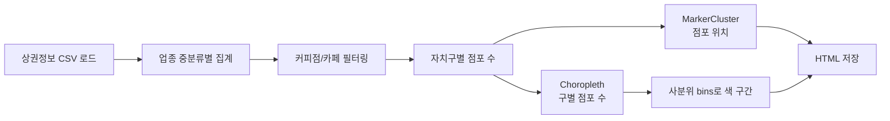

# 🗺️ 서울시 자치구별 상권정보 지도 시각화

| 항목 | 내용 |
|---|---|
| 목적 | 업종별 점포 분포를 자치구 단위 지도로 시각화 |
| 데이터 | [소상공인시장진흥공단 상가(상권)정보](https://www.data.go.kr/data/15083033/fileData.do), [서울 자치구 경계 GeoJSON](https://github.com/southkorea/seoul-maps) |
| 도구 | pandas, folium (MarkerCluster, Choropleth), seaborn |

## 진행 순서

## 주요 내용

| 단계 | 내용 |
|---|---|
| 기본 지도 | 서울 중심 좌표로 folium 지도 생성, `Stamen Toner` · `cartodbpositron` 타일 비교 |
| 경계 표시 | 자치구 GeoJSON으로 구 경계 시각화 |
| 업종 분석 | `상권업종중분류명` 기준 점포 수 막대그래프 |
| 카페 분포 | 커피점/카페는 **강남구가 가장 많고 강북구가 가장 적음** |
| 클러스터 | MarkerCluster로 점포 위치를 묶어 표시 |
| 단계 구분도 | Choropleth로 구별 점포 수를 색으로 표현, 1/4·2/4·3/4 분위수 구간 |

## 참고

- [Folium documentation](https://python-visualization.github.io/folium/)
- 노트북 용량(약 26MB)은 지도 출력이 저장되어 있기 때문입니다. GitHub에서 지도가 보이지 않으면 상단의 Colab 링크로 열어 주세요.
