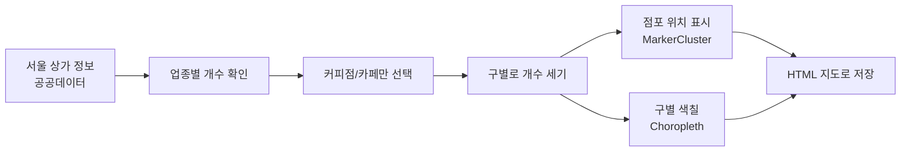

# 서울시 카페 분포 지도 시각화

> 서울에 있는 상가 정보를 지도 위에 올려, 
> 커피점/카페가 어느 구에 많고 적은지를 한눈에 보여주는 시각화 실습입니다.

## 프로젝트 개요

- **목표**: 업종별 점포 분포를 자치구 단위 지도로 시각화해 지역 간 차이를 직관적으로 표현
- **내용**: 서울시 자치구별 업종(커피점/카페) 분포 지도
- **방법**: 공공데이터 상가 정보 → 자치구별 집계 → folium으로 지도 시각화
- **결과**: 카페는 강남구에 가장 많고 강북구에 가장 적음을 지도로 확인, HTML 지도 파일로 저장

## 프로젝트 목표

상권 분석에서는 "어느 업종이 몇 개 있는가"만큼 "어디에 몰려 있는가"가 중요합니다. 
숫자 표로는 지역 간 차이를 한눈에 보기 어렵기 때문에, 
위치 데이터를 지도 위에 표현해 분포를 바로 읽을 수 있게 하는 것이 목표였습니다.

## 수행 내용

**① 기본 지도와 구 경계 그리기**

Python 지도 라이브러리 folium으로 서울 중심의 지도를 만들고, 
자치구 경계선 데이터(GeoJSON)를 올렸습니다. 
배경 지도 스타일도 두 가지(`Stamen Toner`, `cartodbpositron`)를 비교했습니다.

**② 업종별 점포 수 확인**

소상공인시장진흥공단의 서울 상가 정보에서 업종별 점포 수를 막대그래프로 확인한 뒤, 
커피점/카페만 골라 구별로 개수를 셌습니다.

**③ 두 가지 방식으로 지도에 표시**

| 방식 | 보여주는 것 |
|---|---|
| MarkerCluster | 각 카페의 위치를 점으로 표시하되, 가까운 점끼리 묶어 숫자로 보여줌. 확대하면 개별 위치가 보임 |
| Choropleth (단계 구분도) | 구 전체를 카페 수에 따라 진하고 연하게 색칠 |

카페 수가 일부 구에 몰려 있으면 나머지 구는 색 차이가 잘 보이지 않습니다. 
그래서 전체를 4등분하는 사분위수 기준으로 색 구간을 나눠, 구 사이의 차이가 잘 드러나도록 했습니다.

## 결과

- 커피점/카페는 **강남구에 가장 많고, 강북구에 가장 적었습니다**.
- 완성한 지도는 `save()`로 HTML 파일로 저장해, 
  브라우저에서 확대·축소하며 볼 수 있게 했습니다.

**지도 바로 보기** (클릭하면 브라우저에서 확대·축소할 수 있습니다)

| 지도 | 내용 |
|---|---|
| [카페 위치 클러스터 지도](https://mjk022.github.io/portfolio/seoul-cafe/cafe_cluster.html) | 서울 카페 위치를 묶어서 표시, 확대하면 개별 위치 확인 (약 11MB라 로딩에 몇 초 걸림) |
| [자치구별 단계 구분도](https://mjk022.github.io/portfolio/seoul-cafe/cafe_choropleth.html) | 구별 카페 수를 색 농도로 표시 |
| [자치구별 단계 구분도 (사분위)](https://mjk022.github.io/portfolio/seoul-cafe/cafe_choropleth_quartile.html) | 사분위수 기준으로 색 구간을 나눈 버전 |

## 파일 구성

| 파일 | 설명 |
|---|---|
| `folium_서울시 자치구별 상권정보_클러스터 및 시각화.ipynb` | 데이터 집계부터 지도 시각화, HTML 저장까지 |

GitHub는 노트북 안의 지도를 표시하지 않기 때문에, 노트북에서는 지도 출력을 빼고 
위의 링크에서 지도를 볼 수 있게 했습니다.

## 참고

- 데이터: [소상공인시장진흥공단 상가(상권)정보](https://www.data.go.kr/data/15083033/fileData.do), 
  [서울 자치구 경계 GeoJSON](https://github.com/southkorea/seoul-maps)
- [Folium documentation](https://python-visualization.github.io/folium/)
