# 연극·뮤지컬 맞춤 추천 시스템
#### (캡스톤 디자인)

> "이 공연이 좋았다면 이 공연도 좋아할 거예요." 
> 공연의 줄거리, 장르, 포스터, 관객 별점을 분석해 연극과 뮤지컬을 추천하는 시스템입니다.

## 프로젝트 개요

- **목표**: 공연 정보와 관객 별점을 활용해 사용자 취향에 맞는 연극·뮤지컬 추천
- **내용**: 연극·뮤지컬 추천 시스템 (신규 고객용, 기존 고객용)
- **방법**: 인터파크 데이터 수집 → 줄거리·장르 유사도 기반 추천 → 
  협업 필터링과 결합
- **결과**: 기존 고객 대상 추천 정확도(Precision@10) 0.4~0.5, 
  웹사이트로 구현 ([바로 체험하기](https://mjk022.github.io/portfolio/recommend/))
- **담당**: 데이터 수집(이미지 속 글자 인식), 줄거리·장르 기반 추천

## 프로젝트 목표

공연 티켓 판매량은 늘고 있지만, 
대표적인 예매 사이트에서도 "나에게 맞는 공연"을 추천해 주지는 않습니다. 
공연을 고르려면 소개 글과 리뷰를 하나하나 읽어봐야 하고, 
이 과정이 처음 공연을 보려는 사람에게는 진입장벽이 됩니다. 
그래서 사용자의 취향에 맞는 공연을 바로 추천해 주는 시스템을 만들기로 했습니다.

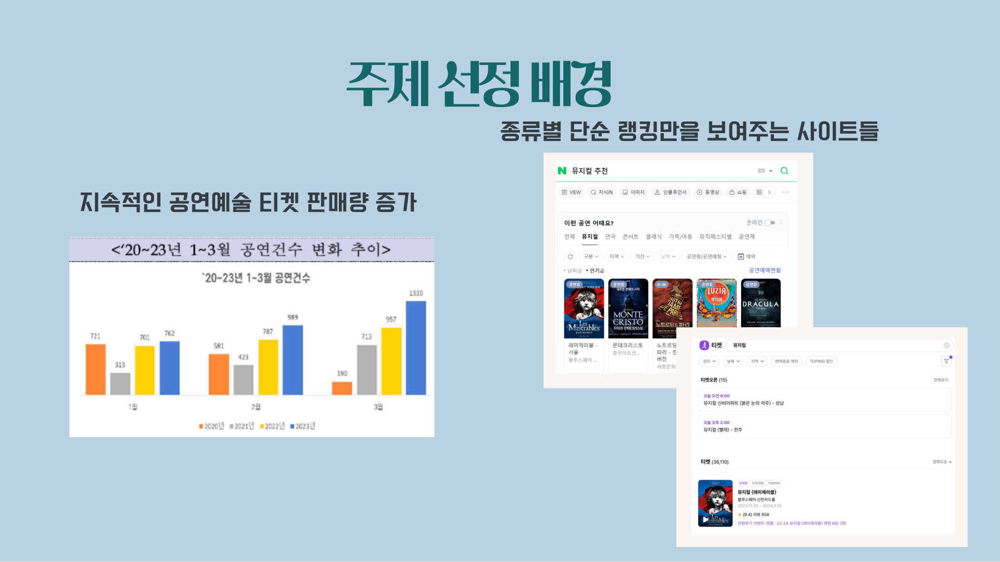

## 수행 내용

**① 데이터 수집 (담당)**

인터파크 월간 랭킹 상위 연극·뮤지컬 각 77편의 정보를 모았습니다. 
문제는 공연 줄거리가 대부분 글자가 아니라 **이미지**로 올라와 있다는 점이었습니다. 
그래서 상세 페이지 이미지를 자동으로 내려받고, 
이미지 속 글자를 읽어내는 OCR(Tesseract)로 줄거리를 추출한 뒤 깨진 문자를 정리했습니다. 
장르는 팀원들과 16개로 직접 분류했습니다.

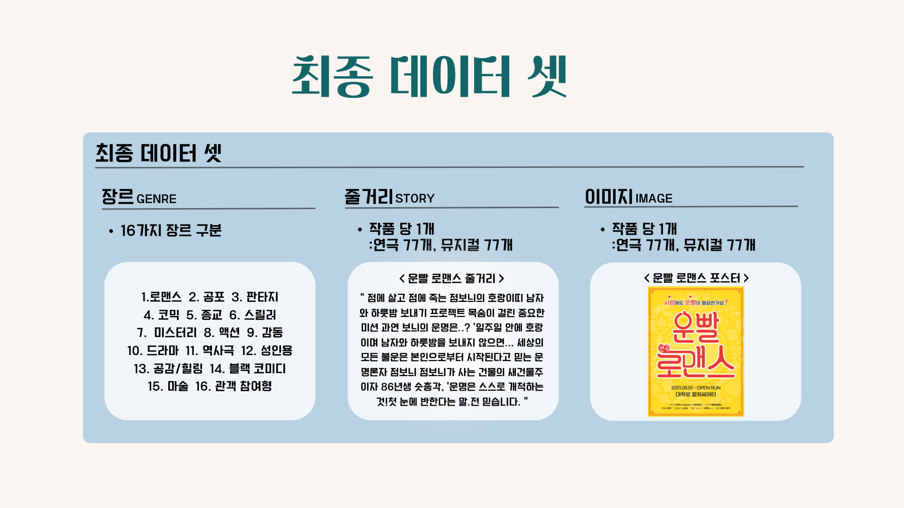

**② 줄거리·장르로 비슷한 공연 찾기 (담당)**

가장 먼저 만든 것은 **콘텐츠 기반 추천**입니다. 
공연 자체의 정보만으로 "비슷한 공연"을 찾는 방식입니다.

| 방법 | 쉽게 말하면 |
|---|---|
| Doc2Vec (줄거리) | 줄거리 문장 전체를 숫자 벡터로 바꿔, 내용이 비슷한 공연끼리 가깝게 배치 |
| TF-IDF (장르) | 공연마다 장르 키워드의 중요도를 점수로 매김 |
| 코사인 유사도 | 두 공연의 벡터가 같은 방향을 가리킬수록 비슷하다고 판단 |

별점도 활용하려 했지만, 
대부분의 공연이 평균 4.85점 이상이라 별점만으로는 차이를 내기 어려웠습니다. 
그래서 일정 기준 이상의 공연 안에서만 추천하는 방식도 함께 실험했습니다.

**③ 최종 시스템으로 확장 (팀)**

중간 발표 이후, 관람 기록이 없는 **신규 사용자**와 별점 기록이 있는 **기존 사용자**를 나눠 
두 가지 시스템으로 발전시켰습니다.

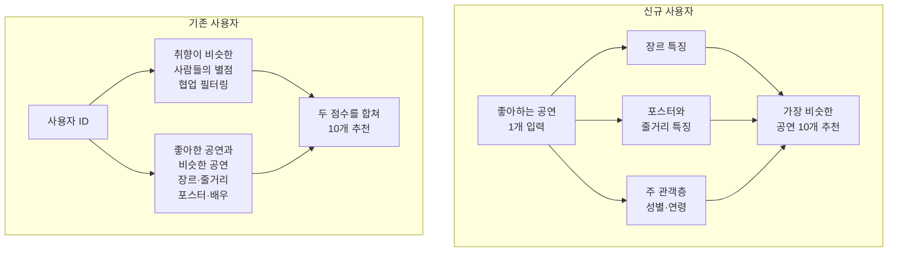

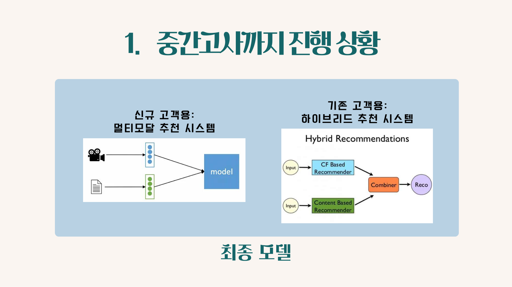

**신규 고객 추천 시스템** 
관람 기록이 없어도 좋아하는 공연 하나만 입력하면 비슷한 공연 10개를 추천합니다.

| 구성 요소 | 방법 |
|---|---|
| 장르 모델 | 16개 장르를 one-hot으로 만든 뒤 AutoEncoder로 압축해 장르 특징 벡터 생성 |
| 이미지·줄거리 모델 | Show and Tell 구조로 포스터(ResNet 인코더)와 줄거리(Kor2vec 임베딩, LSTM 디코더)를 함께 학습 손실 함수: Smooth L1 Loss |
| 사용자 통계 | 주 관객층의 성별 비율과 최다 연령대를 벡터로 변환 |
| 최종 모델 | 세 벡터를 이어 붙인 뒤 유클리드 거리가 가장 가까운 공연 10개 추천 |

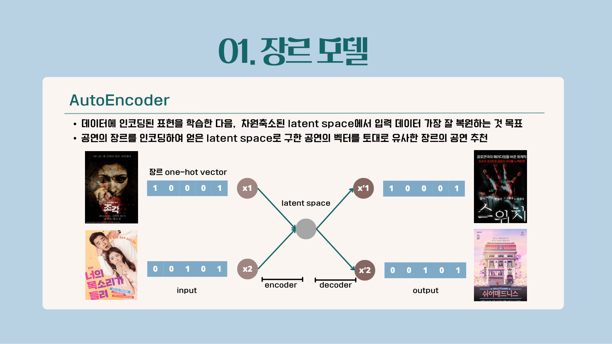

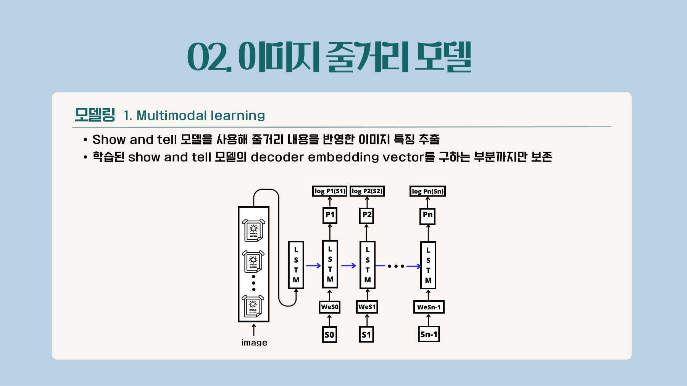

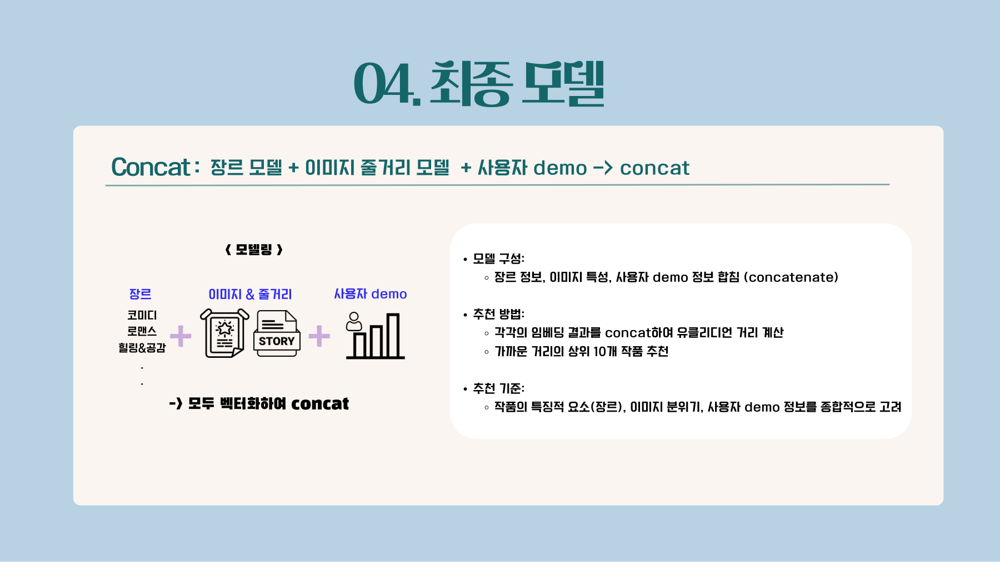

공포 연극 「조각」을 입력하면, 
같은 공포·스릴러 장르이면서 포스터 분위기도 비슷한 공연이 추천되었습니다.

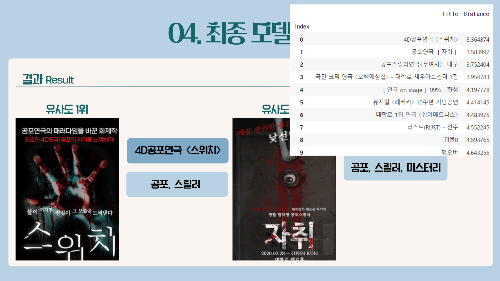

**기존 고객 추천 시스템** 
별점 기록이 있는 사용자에게 두 가지 점수를 합쳐 추천합니다.

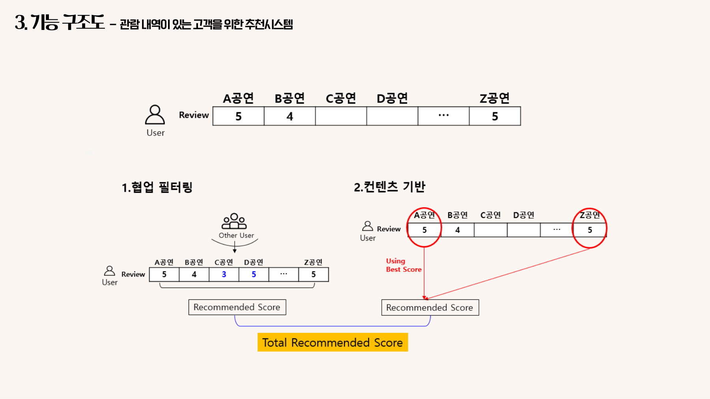

콘텐츠 기반 점수는 사용자가 가장 높은 별점을 준 공연을 기준으로, 
네 가지 요소를 각각 0~5점으로 환산해 더합니다.

| 요소 | 방법 |
|---|---|
| 장르 | 장르 키워드 TF-IDF 벡터의 코사인 유사도 |
| 줄거리 + 포스터 | 줄거리는 SBERT를 미세조정해 문장 임베딩, 포스터는 VGG16으로 임베딩한 뒤 이어 붙여 코사인 유사도 |
| 별점 | 별점을 남긴 사용자 수가 많을수록 신뢰도가 높도록 가중치 보정 |
| 배우 | 같은 배우가 출연하면 1점, 인기 배우 랭킹에 든 배우가 출연하면 2.5점 가산 |

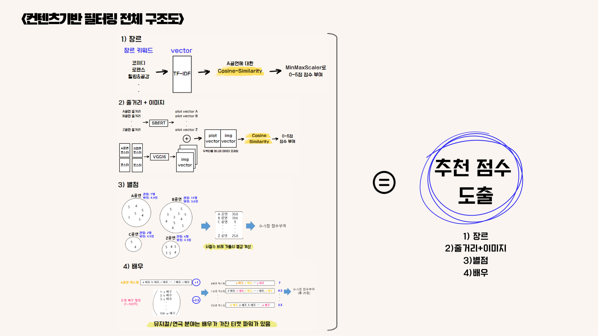

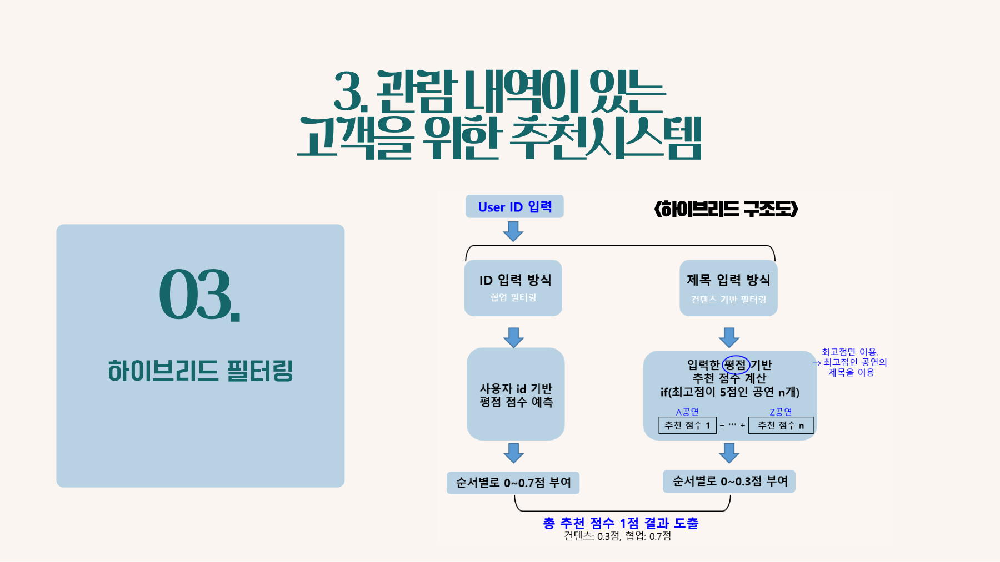

## 결과

기존 고객 시스템이 추천한 10개 중 
실제로 그 사용자가 본 공연이 몇 개인지로 성능을 평가했습니다.

| 사용자 유형 | 관람 수 | Precision@10 (추천 10개 중 적중 비율) | Hit rate (본 공연 중 추천에 포함된 비율) |
|---|---|---|---|
| 연극 위주로 본 사용자 | 11 | 0.5 | 0.45 |
| 뮤지컬 위주로 본 사용자 | 11 | 0.4 | 0.36 |
| 둘 다 고루 본 사용자 | 6 | 0.5 | 0.83 |

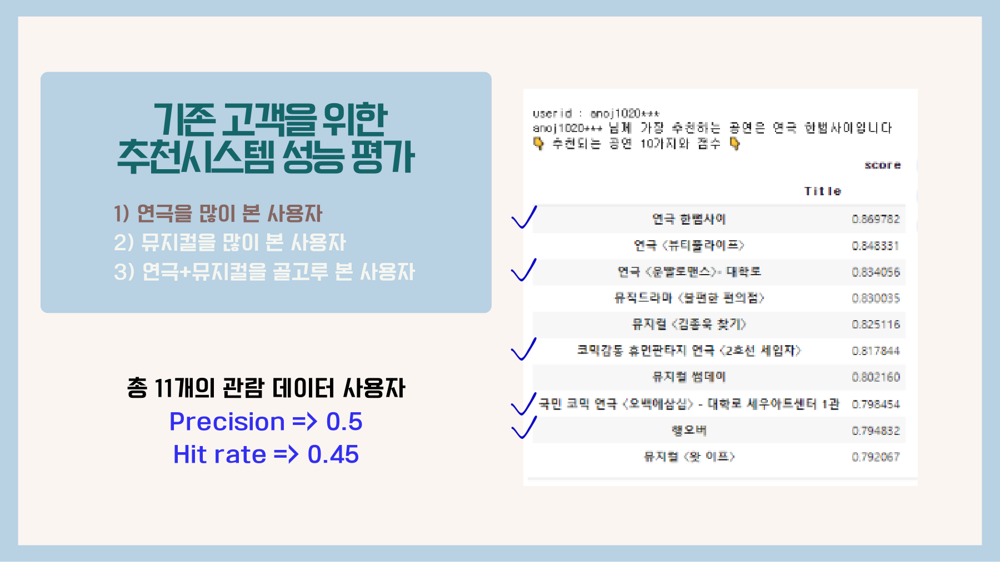

두 시스템을 웹사이트로 구현해, 
공연 제목이나 사용자 ID를 입력하면 추천 결과와 세부 점수를 보여주도록 했습니다.

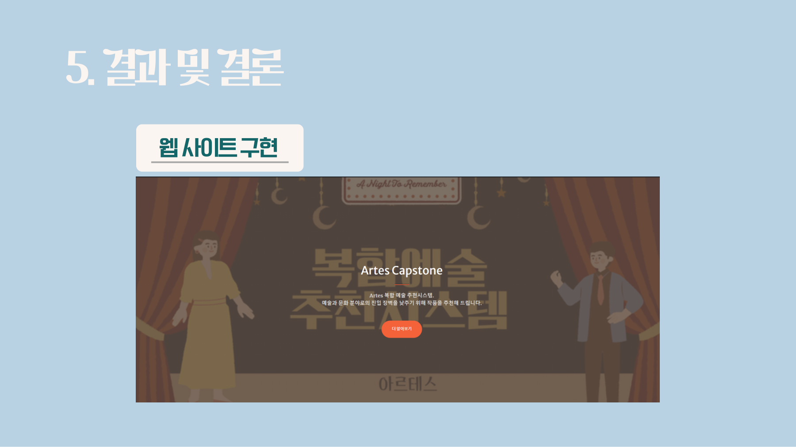

## 웹 서비스

### [추천 바로 체험하기](https://mjk022.github.io/portfolio/recommend/)

팀에서 Django로 만든 추천 웹사이트를, 
설치 없이 누구나 브라우저에서 볼 수 있도록 정적 페이지로 옮겼습니다. 
원본 Django 코드는 [Recommendation_Web](https://github.com/lightwsrld/Recommendation_Web) 저장소에 있습니다.

| 메뉴 | 사용 방법 |
|---|---|
| 신규 고객 | 좋아하는 공연을 하나 고르면, 장르·포스터·줄거리·관객층이 가장 비슷한 공연 10개를 포스터와 함께 보여 줌 |
| 기존 고객 | 예시 사용자를 고르면, 그 사용자가 별점을 남긴 공연과 하이브리드 추천 결과 10개를 보여 줌 |

추천 결과는 Django 웹사이트와 같은 추천 코드로 127개 공연 전체와 예시 사용자 6명에 대해 미리 계산했습니다. 
예시 사용자는 별점을 11개 이상 남긴 실제 관객이며, 
개인정보 보호를 위해 아이디를 "사용자 N"으로 바꿨습니다.

## 한계

랭킹 기반으로 데이터를 모았기 때문에 특정 기간의 공연만 포함되었고, 
공연마다 리뷰 수 차이가 커서 각 77편만 사용할 수 있었습니다. 
신규 고객 시스템은 비교할 사용자 기록이 없어 정량적으로 평가하지 못했습니다.

## 파일 구성 (담당 부분)

발표 자료의 주요 슬라이드는 `images/` 폴더에 있습니다.

| 파일 | 설명 |
|---|---|
| `인터파크_월간랭킹연극_이미지_OCR 및 전처리.ipynb` | 공연 상세 이미지 수집, OCR로 줄거리 추출 및 정리 |
| `Doc2Vec_줄거리유사도.ipynb` | 줄거리 기반 유사 공연 추천 |
| `tfidfVec_장르유사도.ipynb` | 장르 기반 유사 공연 추천 |
| `tfidfVec_(줄거리+장르)유사도.ipynb` | 줄거리와 장르를 합친 추천 |
| `장르별_추천유사도.ipynb` | TF와 TF-IDF 비교, 별점 조건을 건 추천 방식 실험 |

데이터 수집 코드는 [크롤링](../크롤링) 폴더에도 있습니다.
