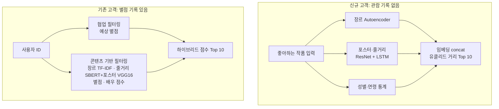

# 🎭 복합 예술(연극·뮤지컬) 추천 시스템

| 항목 | 내용 |
|---|---|
| 과목 | 캡스톤 디자인 (2023-2, 4인 팀) |
| 배경 | 예매 사이트에 개인 맞춤 추천이 없어, 관객이 모든 공연의 소개와 리뷰를 직접 확인해야 함 |
| 데이터 | 인터파크 월간 랭킹 연극·뮤지컬 각 TOP 77 (줄거리, 포스터, 배우, 별점·리뷰, 예매자 통계) → 16개 장르 직접 라벨링 |
| 담당 (이 폴더) | 데이터 수집(OCR), 콘텐츠 기반 필터링 — 줄거리 · 장르 유사도 |
| 도구 | Selenium, Tesseract OCR, KoNLPy, gensim(Doc2Vec), scikit-learn(TF-IDF) |

## 최종 시스템 구조 (팀 전체)

## 이 폴더의 노트북

| 파일 | 내용 |
|---|---|
| `인터파크_월간랭킹연극_이미지_OCR 및 전처리.ipynb` | 공연 상세 이미지를 크롤링하고 Tesseract OCR로 줄거리 텍스트 추출 · 정제 |
| `Doc2Vec_줄거리유사도.ipynb` | 줄거리를 형태소 분석 후 Doc2Vec으로 임베딩, 유사 공연 추천 |
| `tfidfVec_장르유사도ipynb` | 장르 키워드 TF-IDF + 코사인 유사도 |
| `tfidfVec_(줄거리+장르)유사도.ipynb` | 줄거리와 장르를 합쳐 TF-IDF 유사도 |
| `장르별_추천유사도.ipynb` | TF vs TF-IDF 비교, 별점·투표수 조건을 건 추천 방식 실험 |

## 성능 평가 (기존 고객 하이브리드 모델, 팀 결과)

| 사용자 유형 | 관람 수 | Precision@10 | Hit rate |
|---|---|---|---|
| 연극 위주 | 11 | 0.5 | 0.45 |
| 뮤지컬 위주 | 11 | 0.4 | 0.36 |
| 연극·뮤지컬 고루 | 6 | 0.5 | 0.83 |

## 한계

- 랭킹 기반이라 특정 기간 공연만 포함, 공연별 리뷰 수 차이로 각 77편만 사용
- 신규 고객 모델은 사용자 데이터가 없어 정량 평가 불가
